# NAYARA Project Alignment Audit

**Project:** NAYARA — Hijab ERP  
**Path:** `D:\Magang\hijab`  
**Status Evaluasi:** AUDIT COMPLETE & 100% ALIGNED (FINAL BUSINESS FLOW VERIFIED)  
**Tanggal Audit:** 29 September 2026  
**Baseline Git HEAD:** `85e32ce` (*style: polish password reset and purchase interfaces*)  

---

## 1. Project Identity

### 1.1 Judul Resmi Project
> **RANCANG BANGUN SISTEM PERENCANAAN KEBUTUHAN BAHAN DAN PERHITUNGAN HASIL PRODUKSI HIJAB BERBASIS WEB**

### 1.2 Konteks Bisnis Make-to-Order & Saluran Pemesanan
NAYARA bukan merupakan sistem perdagangan e-commerce produk jadi (*ready-stock store*), melainkan sistem manufaktur dan operasional konveksi hijab berbasis pesanan (**Make-to-Order / MTO**). Karakteristik mendasar dari model bisnis ini meliputi:
1. **Saluran Komunikasi Pemesanan (WhatsApp-Driven):** Pesanan masuk melalui komunikasi langsung antara pelanggan dengan Admin via WhatsApp. Admin bertindak sebagai operator yang memvalidasi ketersediaan kapasitas dan spesifikasi sebelum membukukan Sales Order.
2. **Produksi Dipicu oleh Pesanan:** Bahan baku tidak dipotong atau dijahit sebelum adanya pesanan definitif dari pelanggan (*Customer Order*) yang telah disepakati (*DEAL*).
3. **Kebutuhan Bahan Dinamis:** Setiap pesanan memiliki spesifikasi produk, varian motif/warna, dan ukuran tertentu yang merujuk pada resep bahan baku (*Bill of Materials* / BOM). Kebutuhan bahan dihitung tepat sesuai kuantitas target produksi per batch.
4. **Pemisahan Desain/Katalog dengan Penjadwalan Batch:** Master varian produk dapat didaftarkan tanpa harus mengunci kuantitas atau biaya produksi di muka; parameter operasional dan tarif riil baru dibekukan (*snapshot*) saat Batch Produksi diterbitkan oleh Admin.
5. **Bukan Aplikasi Akuntansi Lengkap:** Sistem ini difokuskan pada rantai operasional manufaktur (*supply chain, MRP, inventory traceability, production tracking, QC, and batch costing*), bukan perangkat lunak buku besar akuntansi (*General Ledger, Chart of Accounts, Journal Voucher*).

### 1.3 Core Academic Focus
Sesuai rancangan proposal dan tujuan akademik, fokus inti sistem terpusat pada:
1. **Perhitungan Kebutuhan Material (MRP):**  
   $$\text{Required Quantity} = \text{BOM Quantity per Unit} \times \text{Production Target / Order Quantity}$$
2. **Pengecekan Stok & Kalkulasi Shortage:**  
   $$\text{Historical Shortage} = \max(\text{Required Quantity} - \text{Warehouse Live Stock}, 0)$$
3. **Pengadaan Presisi:** Pengajuan Purchase Order (PO) ke pemasok hanya untuk kuantitas bahan yang mengalami kekurangan (*shortage*).
4. **Jejak Audit Persediaan (Stock Traceability):** Pencatatan riwayat setiap mutasi fisik material masuk (*IN*), alokasi keluar (*OUT*), dan penyesuaian (*ADJUSTMENT*) dengan saldo sebelum, saldo sesudah, dokumen referensi, dan identitas aktor.
5. **Pencatatan Hasil Produksi & Evaluasi Kualitas (QC):**  
   $$\text{Variance} = \text{Actual Quantity} - \text{Target Quantity}$$  
   $$\text{Good Quantity} + \text{Reject Quantity} = \text{Actual Quantity}$$  
   *(Catatan: Reject adalah **Cacat Final**. Alur Rework **TIDAK DIGUNAKAN** dalam proses bisnis konveksi NAYARA).*
6. **Perhitungan Harga Pokok Produksi (HPP):** Kalkulasi biaya riil material terpakai dan tarif proses langsung per batch berdasarkan unit *Good* yang lolos inspeksi QC.

---

## 2. Source of Requirements & Priority

Audit ini menerapkan hirarki kepatuhan (*Source of Truth Priority*) sebagai berikut:

```
┌────────────────────────────────────────────────────────┐
│  PRIORITAS 1: ARAHAN TERBARU PEMBIMBING / USER         │
│  - Alur Pemesanan Utama: Customer memesan via WhatsApp │
│  - Sales Order & Batch Produksi EKSKLUSIF dibuat Admin │
│  - Target Tanggal Produksi Wajib & Terlihat Produksi   │
│  - Actual Qty <= Target Qty (Server-Side Guard)        │
│  - Good Qty <= Actual Qty, Reject Qty Auto-Computed    │
│  - Tanggal/Waktu QC Auto-Generated dari Event (WIB)    │
│  - Progres Batch Independen di Kanban Admin            │
│  - Dua Kondisi Customer (Biasa via WA vs Langganan)    │
│  - Customer Portal HANYA untuk Tracking/Riwayat        │
│  - TIDAK ADA Rework (Reject adalah Cacat Final)        │
│  - Gudang mengelola MRP, stok fisik, & Purchase Order  │
│  - Produksi/QC mencatat hasil aktual, defect, & packing│
│  - Owner memantau HPP, profitabilitas, & metrik bisnis │
│  - Harga Jual dikelola Admin (bukan auto-markup HPP)   │
└───────────────────────────┬────────────────────────────┘
                            │
┌───────────────────────────▼────────────────────────────┐
│  PRIORITAS 2: PROPOSAL PROJECT                         │
│  - Fokus Make-to-Order & alur manufaktur hijab         │
│  - Kalkulasi MRP berbasis BOM × Target Order           │
│  - Shortage bahan baku & Purchase Order                │
│  - Alokasi material, Stock In, Stock Out               │
│  - Target vs Actual, Good / Reject                     │
│  - Ketertelusuran (Traceability) operasional           │
└───────────────────────────┬────────────────────────────┘
                            │
┌───────────────────────────▼────────────────────────────┐
│  PRIORITAS 3: IMPLEMENTASI EXISTING                    │
│  - Arsitektur Laravel ERP (Routes, Services, Models)   │
│  - Moving Weighted Average (MWA) unit cost             │
│  - Row-locking pessimistic concurrency (lockForUpdate) │
│  - Presisi finansial BCMath (Desimal 18,4 / 18,2)      │
│  - Fitur pendukung: Invoicing, Payment, Expense        │
└────────────────────────────────────────────────────────┘
```

### Penegasan Dua Kondisi Customer
1. **Customer Biasa / Customer Baru:**
   - Memesan dan berkomunikasi sepenuhnya melalui WhatsApp.
   - Tidak diwajibkan memiliki akun login ke sistem ERP.
   - Admin mencatat data Customer dan membuat Sales Order di sistem internal.
2. **Customer Langganan:**
   - Dapat diberikan akun akses ke Customer Portal oleh Admin.
   - Menggunakan portal untuk: login, melihat riwayat pesanan, memantau detail & progress pengerjaan, dan melihat nomor resi pengiriman (*Tracking*).
   - **TIDAK DIBEBANKAN** membuat Sales Order sendiri (bukan sistem keranjang belanja / e-commerce checkout).

### Penegasan Alur QC (Zero Rework)
- Proposal awal sempat menyebut frasa "Good / Reject / Rework".
- Kebutuhan authoritative final mengunci bahwa pada konveksi hijab NAYARA, produk reject tidak dapat dibongkar/dikerjakan ulang secara ekonomis.
- **Reject adalah Cacat Final**. Persamaan QC adalah mutlak: $\text{Good Qty} + \text{Reject Qty} = \text{Actual Qty}$.

---

## 3. Authoritative Business Flow

Siklus bisnis terpadu NAYARA mengikuti alur otoritatif end-to-end sebagai berikut:

```mermaid
flowchart TD
    subgraph S1["1. Tahap Pemesanan & Pembayaran DP (WhatsApp & Admin)"]
        A1["Customer: Pesan & Diskusi Desain via WhatsApp"] --> A2["Admin: Cari / Input Data Customer"]
        A2 --> A3["Admin: Buat Sales Order (Status: KOMUNIKASI)"]
        A3 --> A4["Admin: Input Varian, Kuantitas, & Harga Jual Kesepakatan"]
        A4 --> A5["Admin: Konfirmasi DEAL (Status Order: DEAL)"]
        A5 --> A6["Admin: Terbitkan Invoice Tagihan"]
        A6 --> A7["Customer Bayar DP & Admin Konfirmasi Pembayaran (Confirmed DP > 0)"]
    end

    subgraph S2["2. Perencanaan Batch (Admin Only - Memerlukan Confirmed DP)"]
        A7 --> B1["Admin: Buat Production Batch (Target Qty <= Sisa Order, DP Valid)"]
        B1 --> B2["Sistem: Kunci Snapshot Tarif Proses Langsung & BOM Varian"]
        B2 --> B3["Sistem: Transisi Status Order ke BAHAN"]
    end

    subgraph S3["3. Penyiapan Bahan & MRP (Gudang)"]
        B3 --> C1["Gudang: Buka Perencanaan Bahan (MRP Batch)"]
        C1 --> C2["Sistem: Hitung Required Qty & Live Shortage"]
        C2 --> C3{"Apakah Stok Gudang Cukup?"}
        C3 -- "Kurang (Shortage > 0)" --> C4["Gudang: Terbitkan Purchase Order ke Supplier"]
        C4 --> C5["Supplier Kirim Bahan & Gudang Terima Penuh (Full Receiving)"]
        C5 --> C6["Sistem: Mutasi IN, Update MWA, Saldo Bertambah"]
        C6 --> C7["Gudang: Konfirmasi Alokasi Bahan ke Batch (Full Allocation)"]
        C3 -- "Cukup (Shortage = 0)" --> C7
        C7 --> C8["Sistem: Mutasi OUT, Kunci Snapshot Harga Modal Bahan"]
    end

    subgraph S4["4. Fabrikasi & QC (Produksi)"]
        C8 --> D1{"Apakah Varian Perlu Printing?"}
        D1 -- "Ya" --> D2["Produksi: Mulai & Selesaikan Tahap Printing"]
        D1 -- "Tidak" --> D3["Produksi: Mulai Tahap Jahit & Finishing"]
        D2 --> D3
        D3 --> D4["Produksi: Catat Hasil Aktual & Bahan Terpakai (used_qty)"]
        D4 --> D5["Sistem: Transisi Batch ke QC, Hitung Variansi Target vs Aktual"]
        D5 --> D6["Produksi/QC: Catat Good Qty & Reject Cacat Final (Good + Reject = Actual)"]
        D6 --> D7["Produksi: Pengemasan (Packing) & Selesaikan Batch (Status: SELESAI)"]
    end

    subgraph S5["5. Pengiriman & Keuangan (Admin, Produksi, Owner, Customer Portal)"]
        D7 --> E0["Admin: Konfirmasi Pelunasan Sisa Pembayaran (Invoice LUNAS / PAID)"]
        E0 --> E1["Produksi: Siapkan & Eksekusi Pengiriman (Shipment) Saat Lunas"]
        E1 --> E2["Customer Langganan: Pantau Progress & Lacak Resi di Portal"]
        D7 --> E3["Sistem: Validasi Kesiapan HPP Batch (Status: READY)"]
        E3 --> E4["Owner: Pantau Realisasi HPP, Profit Per Order, & Kinerja Finansial"]
    end
```



---

## 4. Role Responsibilities & Access Control Matrix

Sistem NAYARA membagi tanggung jawab pengguna ke dalam lima peran independen dengan pembatasan otorisasi di level server (*Middleware & Route Groups*):

| Role | Tanggung Jawab Operasional | Scope Akses Data & Larangan Keras |
| :--- | :--- | :--- |
| **CUSTOMER** | • Login portal khusus customer langganan<br>• Melacak status progres tahapan pesanan real-time<br>• Melihat riwayat pesanan, rincian item, tagihan, & resi pengiriman | **Hanya melihat data pesanan miliknya sendiri** (terisolasi via IDOR guard). **DILARANG KERAS** melihat HPP, harga modal bahan, identitas supplier, dan metrik profit. **TIDAK DIBEBANKAN** membuat Sales Order (bukan keranjang belanja). |
| **ADMIN** | • Menerima pesanan via WhatsApp & input master Customer<br>• Buat & kelola Sales Order, tetapkan harga jual transaksi<br>• Konfirmasi DEAL dan batalkan pesanan jika batal<br>• **SATU-SATUNYA pembuat Production Batch & penentu target produksi**<br>• Terbitkan Invoice, catat Pembayaran, & kelola Beban Operasional | Akses operasional menyeluruh pada entitas penjualan, perencanaan batch, dan administrasi keuangan. Tidak melakukan eksekusi fisik gudang atau pencatatan QC jahit. |
| **GUDANG** | • Kelola Master Material, Satuan Unit, & Pemasok (Supplier)<br>• Hitung MRP Batch & pantau *live shortage* bahan<br>• Kelola Purchase Order & terima barang (*Full Receiving*)<br>• Alokasikan bahan ke batch (*Physical Allocation / Stock OUT*)<br>• Lakukan Stock Opname (*Adjustment*) & pantau histori stok | Mengelola stok fisik. **DILARANG MEMBUAT BATCH PRODUKSI**. Tidak mencatat hasil jahit atau inspeksi QC. |
| **PRODUKSI** | • Lihat antrean Batch Produksi & target kuantitas yang diterbitkan Admin<br>• Jalankan proses Printing & Finishing<br>• Catat Hasil Produksi Aktual (*actual_qty*) & pemakaian riil bahan (*used_qty*)<br>• Catat inspeksi QC (*good_qty* & *reject_qty* cacat final)<br>• Selesaikan proses Packing | Melakukan eksekusi manufaktur. **DILARANG MEMBUAT BATCH PRODUKSI**. Tidak ada alur Rework. Tidak mengelola harga jual atau pembelian bahan. |
| **OWNER** | • Pantau Dashboard Eksekutif & grafik tren performa bisnis<br>• Analisis HPP aktual per batch dan per pesanan (Read-Only)<br>• Pantau Laba Kotor (*Gross Profit*) & Laba Bersih (*Net Profit*)<br>• Evaluasi indikator finansial periode (ROI, MER, EBITDA) | **Hanya Read-Only Analytics**. Tidak memiliki tombol mutasi data operasional (tidak membuat PO, invoice, atau batch). |

### Matriks Akses Server-Side (Route & Middleware Audit)

| Endpoint / Fungsionalitas | Customer | Admin | Gudang | Produksi | Owner | Status Implementasi |
| :--- | :---: | :---: | :---: | :---: | :---: | :--- |
| `GET /customer/orders/*` | ✅ | ❌ | ❌ | ❌ | ❌ | **PASS** (Protected by `role:CUSTOMER`, IDOR isolated) |
| `POST /admin/orders` | ❌ | ✅ | ❌ | ❌ | ❌ | **PASS** (Protected by `role:ADMIN` — WhatsApp orders recorded here) |
| `POST /admin/orders/{order}/batches` | ❌ | ✅ | ❌ | ❌ | ❌ | **PASS** (**ADMIN ONLY** — Gudang/Produksi diblokir) |
| `GET /gudang/material-planning/*` | ❌ | ❌ | ✅ | ❌ | ❌ | **PASS** (Protected by `role:GUDANG`) |
| `POST /gudang/purchases/{po}/receive` | ❌ | ❌ | ✅ | ❌ | ❌ | **PASS** (Protected by `role:GUDANG`) |
| `POST /gudang/material-planning/{b}/allocate` | ❌ | ❌ | ✅ | ❌ | ❌ | **PASS** (Protected by `role:GUDANG`) |
| `POST /produksi/batches/{b}/production-result` | ❌ | ❌ | ❌ | ✅ | ❌ | **PASS** (Protected by `role:PRODUKSI`) |
| `POST /produksi/batches/{b}/qc` | ❌ | ❌ | ❌ | ✅ | ❌ | **PASS** (Protected by `role:PRODUKSI`) |
| `GET /owner/hpp/*` | ❌ | ❌ | ❌ | ❌ | ✅ | **PASS** (Protected by `role:OWNER`) |
| `GET /owner/performance` | ❌ | ❌ | ❌ | ❌ | ✅ | **PASS** (Protected by `role:OWNER`) |

---

## 5. Alignment Matrix

Berikut adalah evaluasi rinci setiap modul dan fitur berdasarkan sumber kebutuhan, realitas kode saat ini, dan status keselarasan final:

| Role | Modul / Fitur | Source | Current Implementation | Status | Analisis & Rekomendasi | Priority |
| :--- | :--- | :--- | :--- | :--- | :--- | :---: |
| **Customer** | Registrasi & Login Langganan | SUPERVISOR ADDITION | `routes/web.php`, `LoginController` | **DONE** | Disediakan bagi customer langganan untuk memantau pesanan aktif. | P2 |
| **Customer** | Lacak Pesanan Mandiri | PROPOSAL CORE + SUPV | `/track/{token}` & `/customer/orders/{id}` | **DONE** | Pelacakan publik via token unik & privat via portal. | P0 |
| **Customer** | Riwayat & Detail Pesanan | SUPERVISOR ADDITION | `Customer\OrderController@index`, `@show` | **DONE** | Menampilkan rincian pesanan, kuantitas, harga kesepakatan, dan invoice. | P1 |
| **Customer** | Informasi Pengiriman | SUPERVISOR ADDITION | Kartu detail Shipment di detail order | **DONE** | Informasi ekspedisi, kurir, layanan, dan nomor resi. | P1 |
| **Customer** | **Pembuatan Order Mandiri** | **SUPERVISOR CLARIFIED** | **Tidak ada (Sales Order dibuat oleh Admin)** | **NOT REQUIRED** | **Bukan gap.** Alur utama NAYARA berbasis pesanan via WhatsApp yang diinput oleh Admin. Portal pelanggan hanya untuk tracking/history. | **N/A** |
| **Admin** | Kelola Pelanggan (Customer) | PROPOSAL SUPPORT | CRUD lengkap (`Admin\CustomerController`) | **DONE** | Admin mencatat data customer dari kontak WhatsApp. | P2 |
| **Admin** | Kelola Master Produk & Varian | PROPOSAL CORE | CRUD lengkap, Auto SKU, Semantic Code `VP` | **DONE** | Pendaftaran varian hijab tanpa paksaan tarif biaya di awal. | P0 |
| **Admin** | Kelola Bill of Materials (BOM) | PROPOSAL CORE | Resep bahan per varian + Template BOM | **DONE** | Menghubungkan varian produk dengan kebutuhan material. | P0 |
| **Admin** | Kelola Harga Jual | SUPERVISOR ADDITION | Snapshot pada `order_items.unit_selling_price` | **DONE** | Harga jual dikelola Admin secara manual/snapshot per transaksi, tidak diotomatisasi dari HPP. | P0 |
| **Admin** | Sales Order & Konfirmasi Deal | PROPOSAL CORE | Alur `KOMUNIKASI` $\to$ `DEAL` $\to$ `CANCELLED` | **DONE** | Admin membukukan pesanan dari WhatsApp dan mengonfirmasi Deal. | P0 |
| **Admin** | **Pembuatan Batch Produksi** | **SUPERVISOR ADDITION** | `Admin\ProductionBatchController@store` | **DONE** | **Tervalidasi eksklusif milik Admin**. Route/Controller Gudang dan Produksi bersih dari form pembuatan batch. | **P0** |
| **Admin** | Invoicing & Payment | PROPOSAL SUPPORT | `Admin\InvoiceController`, `PaymentController` | **DONE** | Mendukung pencatatan pelunasan tagihan bertahap. | P2 |
| **Admin** | Biaya Operasional (Expense) | PROPOSAL SUPPORT | `Admin\ExpenseController` (6 kategori) | **DONE** | Memisahkan biaya overhead dengan HPP manufaktur. | P2 |
| **Admin** | Kanban & Monitoring Pesanan | PROPOSAL SUPPORT | Board Kanban visual status pesanan | **DONE** | Visualisasi tahapan pesanan konveksi berjalan. | P2 |
| **Gudang** | Kelola Master Bahan, Unit, Supplier | PROPOSAL CORE | CRUD Material, Unit, Supplier lengkap | **DONE** | Master data persediaan bahan baku. | P0 |
| **Gudang** | **Hitung MRP Kebutuhan Batch** | **PROPOSAL CORE** | `BatchMaterialPlanningService` | **DONE** | Perhitungan formula $\text{BOM} \times \text{Target}$ presisi desimal 18,4. | **P0** |
| **Gudang** | **Cek Stok Fisik & Shortage** | **PROPOSAL CORE** | Live shortage vs snapshot historis | **DONE** | Status kesiapan bahan: `SIAP`, `KURANG`, `TERALOKASI`. | **P0** |
| **Gudang** | Kelola Purchase Order | PROPOSAL CORE | PO berstatus `DRAFT`, `ORDERED`, `RECEIVED` | **DONE** | Pengadaan bahan baku untuk menutup shortage. | P0 |
| **Gudang** | Penerimaan Barang (Receiving) | PROPOSAL CORE + SUPV | Full Receiving, Mutasi `IN`, MWA update | **DONE** | Dilarang partial, kebal double receiving. | **P0** |
| **Gudang** | Alokasi Bahan ke Batch | PROPOSAL CORE | `MaterialAllocationService` (Mutasi `OUT`) | **DONE** | Membekukan snapshot biaya material saat barang keluar fisik. | **P0** |
| **Gudang** | Stock History & Audit Trail | PROPOSAL CORE + SUPV | `StockMovementController` & tabel audit | **DONE** | Lengkap: timestamp, saldo sebelum/sesudah, referensi dokumen, aktor. | **P0** |
| **Produksi** | Pemantauan Antrean Batch | PROPOSAL CORE | `Produksi\BatchController@index`, `@show` | **DONE** | Menampilkan batch terbitan Admin yang siap dikerjakan. | P0 |
| **Produksi** | Alur Cetak (Printing) | PROPOSAL CORE | Transisi status `PRINTING` jika varian butuh | **DONE** | Tahapan opsional bagi hijab bermotif cetak. | P1 |
| **Produksi** | **Pencatatan Hasil Aktual** | **PROPOSAL CORE** | `ProductionResultController@store` | **DONE** | Input kuantitas fisik selesai jahit & pemakaian riil material (`used_qty`). | **P0** |
| **Produksi / Gudang** | **Rekonsiliasi Bahan Aktual (Surplus Return & Shortage Allocation)** | **SUPERVISOR REVISION TAHAP 2** | `ProductionResultService`, `MaterialAllocationService` | **DONE** | Sisa bahan otomatis kembali ke stok gudang (Stock IN). Kekurangan dialokasikan via "Tambah Bahan dari Gudang" (Stock OUT). Invarian: NO DOUBLE STOCK OUT. MWA preserved. | **P0** |
| **Produksi** | **Inspeksi QC (Good vs Reject)** | **PROPOSAL CORE** | `QcResultController@store` | **DONE** | Validasi invarian: $\text{Good} + \text{Reject} = \text{Actual}$. Reject adalah cacat final. | **P0** |
| **Produksi** | **Alur Rework (Pengerjaan Ulang)** | **PROPOSAL CORE / FINAL RULE** | **Tidak ada rute/tabel rework di sistem** | **NOT APPLICABLE** | **Bukan gap.** Sesuai arahan final, reject adalah cacat final dan NAYARA tidak menggunakan alur rework. | **N/A** |
| **Produksi** | Pengemasan (Packing) | PROPOSAL CORE | Transisi status `PACKING` $\to$ `SELESAI` | **DONE** | Pengemasan unit Good sebelum diteruskan ke Admin untuk dikirim. | P0 |
| **Owner** | Dashboard Ringkasan Eksekutif | SUPERVISOR ADDITION | `OwnerDashboardAnalyticsService` | **DONE** | Read-only kartu metrik & grafik tren bisnis. | P1 |
| **Owner** | Monitoring HPP Batch & Order | SUPERVISOR ADDITION | `BatchCostCalculationService`, `OrderHppCalculationService` | **DONE** | Terkunci immutable: Material Snapshot + Direct Labor + Printing + Packaging. | P0 |
| **Owner** | Revenue & Gross Profit | SUPERVISOR ADDITION | `PeriodFinancialService` | **DONE** | $\text{Gross Profit} = \text{Revenue} - \text{HPP}$ | P0 |
| **Owner** | Net Profit | SUPERVISOR ADDITION | `PeriodFinancialService` | **DONE** | $\text{Net Profit} = \text{Gross Profit} - \text{Total Expenses}$ | P1 |
| **Owner** | **Return on Investment (ROI)** | **SUPERVISOR ADDITION** | Terhitung di `PeriodFinancialService` | **NEEDS BUSINESS DEFINITION** | Formula teknis: $\frac{\text{Net Profit}}{\text{HPP} + \text{Total Expenses}} \times 100$. Menunggu validasi definisi bisnis resmi dari Pembimbing. | **P1** |
| **Owner** | **Marketing Efficiency Ratio (MER)**| **SUPERVISOR ADDITION** | Terhitung di `PeriodFinancialService` | **NEEDS BUSINESS DEFINITION** | Formula teknis: $\frac{\text{Revenue}}{\text{Marketing Spend}}$. Menunggu konfirmasi relevansi maklun B2B yang minim iklan berbayar. | **P1** |
| **Owner** | **EBITDA** | **SUPERVISOR ADDITION** | Terhitung di `PeriodFinancialService` | **NEEDS BUSINESS DEFINITION** | Formula teknis: $\text{Revenue} - \text{HPP} - \text{Marketing} - \text{Operating}$. Beban depresiasi dicatat via expense manual. | **P1** |

---

## 6. Core Calculation Audit

### 6.1 Perhitungan Kebutuhan Bahan (MRP) & Shortage
- **Lokasi Kode Eksekusi:** [`app/Services/Inventory/BatchMaterialPlanningService.php`](file:///d:/Magang/hijab/app/Services/Inventory/BatchMaterialPlanningService.php#L60-L134)
- **Sumber Target Produksi:** `ProductionBatch.target_qty` (divalidasi $\le$ sisa kuantitas pesanan yang belum dijadwalkan).
- **Sumber Resep BOM:** `BomItem::where('variant_id', $variant->id)->with(['material.unit', 'material.stock'])`.
- **Penanganan Satuan Unit:** Material terikat secara kanonikal ke tabel `units` (`symbol`). Kalkulasi menjaga konsistensi unit dasar bahan baku (misal: meter, yard, roll, pcs).
- **Formula Kebutuhan Bahan:**
  $$\text{required\_qty} = \text{bcmul}(\text{bom\_qty\_per\_unit}, \text{batch.target\_qty}, 4)$$
- **Formula Shortage Historis (Snapshot saat Hitung Batch):**
  $$\text{shortage\_qty} = \begin{cases} \text{bcsub}(\text{required\_qty}, \text{stock\_at\_calc}, 4) & \text{jika } \text{required\_qty} > \text{stock\_at\_calc} \\ 0.0000 & \text{lainnya} \end{cases}$$
- **Formula Shortage Live (Kesiapan Operasional Gudang):**
  $$\text{live\_shortage\_qty} = \max(\text{required\_qty} - \text{material\_stocks.qty\_on\_hand}, 0)$$
  - Jika material sudah dialokasikan penuh (`allocated_qty >= required_qty`), status bahan adalah **`TERALOKASI`** dan efektif shortage adalah `0.0000`.
- **Proteksi Duplikasi & Idempotensi:** Pengecekan row lock pesimis dalam transaksi; jika snapshot `BatchMaterial` untuk batch tersebut sudah terbentuk, kalkulasi ulang diabaikan tanpa menduplikasi baris.
- **Status Audit:** **PASS** (100% tervalidasi via unit test & feature test).

### 6.2 Pencatatan Hasil Produksi & Evaluasi Kualitas (QC)
- **Lokasi Kode Eksekusi:**
  - Hasil Aktual: [`app/Services/Production/ProductionResultService.php`](file:///d:/Magang/hijab/app/Services/Production/ProductionResultService.php#L40-L115)
  - Hasil QC: [`app/Services/Production/QcResultService.php`](file:///d:/Magang/hijab/app/Services/Production/QcResultService.php#L54-L125)
- **Aktor Penginput:** Peran `PRODUKSI` (dicatat server-side dari `auth()->user()->id`).
- **Timing Eksekusi:**
  1. Input Hasil Aktual hanya dapat dilakukan saat batch berstatus `PRODUKSI` dan bahan telah berstatus `TERALOKASI`.
  2. Input Hasil QC hanya dapat dilakukan setelah Hasil Aktual tersimpan dan batch berada di status `QC`.
- **Aturan Revisi Pembimbing — Tahap 1 (Produksi + QC):**
  1. **Batas Atas Hasil Aktual:** $0 < \text{actual\_qty} \le \text{target\_qty}$. Sistem menolak jika kuantitas jahit aktual melebihi target batch yang direncanakan.
  2. **Batas Atas Good Qty QC:** $0 \le \text{good\_qty} \le \text{actual\_qty}$. Kuantitas produk lolos QC tidak boleh melebihi hasil jahit aktual.
  3. **Auto-Kalkulasi Reject Qty:** $\text{reject\_qty} = \text{actual\_qty} - \text{good\_qty}$. Input reject dari antarmuka klien diabaikan secara total di server-side untuk mencegah inkonsistensi manusia (*human error*).
  4. **Auto-Penugasan Tanggal QC & Jejak Audit (Klarifikasi Pembimbing):**
     - Tanggal bisnis QC (`qc_date`) otomatis mengikuti Tanggal Produksi Mulai Dibuat/Dikerjakan (`ProductionBatch.getProductionStartDate()`), bukan tanggal submit form.
     - Pintu Kelayakan (*Date Gate*): QC tidak boleh dilakukan sebelum tanggal produksi (`today in Asia/Jakarta >= production_start_date`). Percobaan simpan sebelum tanggal produksi ditolak server-side (`DomainException: "QC belum dapat dilakukan sebelum tanggal produksi."`).
     - Waktu kejadian aktual (`qc_at`) dicatat otomatis dari event submission (`now()` dalam UTC, tampil WIB) sebagai jejak audit.
     - `planned_end_date` adalah deadline penyelesaian dan BUKAN tanggal QC.
     - Staf produksi tidak dapat menginput maupun memanipulasi `qc_date` atau `qc_at`.
  5. **Visibilitas Target Tanggal:** `planned_end_date` wajib ditetapkan oleh Admin saat pembuatan batch, dan tampil read-only pada daftar batch produksi, detail batch, modal hasil jahit, serta perencanaan bahan gudang.
  6. **Progres Batch Independen:** Setiap batch produksi memperbarui statusnya secara independen di Kanban pesanan Admin tanpa menunggu batch saudara (*sibling batches*).
- **Persamaan Keseimbangan QC (Invarian Mutlak):**
  $$\text{good\_qty} + \text{reject\_qty} == \text{production\_result.actual\_qty}$$
- **Variansi Produksi:**
  $$\text{variance} = \text{actual\_qty} - \text{target\_qty}$$
- **Status Rework:** **NOT APPLICABLE / FINAL FLOW USES REJECT ONLY**. Sesuai arahan authoritative, produk cacat dicatat sebagai `reject_qty` (cacat final) dan tidak ada alur pengerjaan ulang (rework). Implementasi sistem saat ini telah 100% selaras dengan alur bisnis ini.
- **Status Audit:** **PASS** (100% tervalidasi via unit test & feature test).

### 6.3 Kalkulasi Harga Pokok Produksi (HPP)
- **Lokasi Kode Eksekusi:** [`app/Services/Finance/BatchCostCalculationService.php`](file:///d:/Magang/hijab/app/Services/Finance/BatchCostCalculationService.php#L161-L321)
- **Formula HPP Batch:**
  $$\text{Total HPP Batch} = \text{Material Cost} + \text{Printing Cost} + \text{Direct Labor Cost} + \text{Packaging Process Cost} + \text{Other Direct Cost}$$
- **Rincian Komponen:**
  1. **Material Cost:** $\sum (\text{BatchMaterial.used\_qty} \times \text{StockMovement OUT unit\_cost\_snapshot})$. Menggunakan snapshot modal saat alokasi keluar fisik dari gudang; tidak terpengaruh oleh pembelian baru di masa mendatang.
  2. **Printing Cost:** $\text{bcmul}(\text{actual\_qty}, \text{printing\_cost\_per\_unit\_snapshot}, 2)$ (hanya jika varian diset `requires_printing = true`).
  3. **Direct Labor Cost:** $\text{bcmul}(\text{actual\_qty}, \text{direct\_labor\_cost\_per\_unit\_snapshot}, 2)$.
  4. **Packaging Process Cost:** $\text{bcmul}(\text{good\_qty}, \text{packaging\_process\_cost\_per\_good\_unit\_snapshot}, 2)$ (dikalikan unit *Good* lolos QC, mencerminkan biaya kemasan produk jadi yang layak jual).
  5. **Other Direct Cost:** $\text{bcmul}(\text{actual\_qty}, \text{other_direct_cost_per_unit_snapshot}, 2)$.
- **HPP Satuan per Good Piece:**
  $$\text{HPP per Good Pcs} = \frac{\text{Total HPP Batch}}{\text{QcResult.good\_qty}}$$
- **Invarian Kesiapan HPP (Readiness):** HPP Batch bernilai `NULL` (bukan fake Rp 0) jika batch belum berstatus `SELESAI`, pemakaian bahan belum dicatat, atau hasil QC belum final.
- **Ketelitian Numerik:** 100% menggunakan ekstensi `BCMath` (skala 2 untuk mata uang Rupiah, skala 4 untuk kuantitas dan harga satuan modal). Bebas dari floating-point precision error.
- **Status Audit:** **PASS**.

### 6.4 Rekonsiliasi Pemakaian Bahan Aktual Produksi ↔ Gudang (Revisi Pembimbing — Tahap 2)
- **Lokasi Kode Eksekusi:**
  - Pengembalian Surplus: [`app/Services/Production/ProductionResultService.php`](file:///d:/Magang/hijab/app/Services/Production/ProductionResultService.php)
  - Alokasi Tambahan: [`app/Services/Inventory/MaterialAllocationService.php`](file:///d:/Magang/hijab/app/Services/Inventory/MaterialAllocationService.php)
- **Autoritas & Pelaku:** Staf Produksi dapat mencatat pemakaian dan mengajukan alokasi tambahan dari Gudang secara transaksional dengan audit trail lengkap (`auth()->user()->id`).
- **Prinsip & Invarian Inti:**
  1. **NO DOUBLE STOCK OUT:** Bahan yang sudah dikeluarkan saat alokasi awal di gudang tidak boleh dikurangi lagi saat pemakaian riil disimpan.
  2. **Surplus Return ($\text{used} < \text{allocated}$):** Sisa $\text{allocated} - \text{used}$ otomatis kembali ke saldo gudang (`qty_on_hand`) via `StockMovement::IN` dengan catatan `"Pengembalian sisa bahan..."` dan referensi `production_batches`. Valuasi MWA (`avg_unit_cost`) tidak diubah agar tidak terdistorsi.
  3. **Shortfall Allocation ($\text{needed} > \text{allocated}$):** Pemakaian melebihi alokasi diblokir dari finalisasi langsung. Operator menggunakan tombol `"Tambah Bahan dari Gudang"`. Aksi ini memvalidasi $\text{qty\_on\_hand} \ge \text{additional\_qty}$, memotong stok gudang (Stock `OUT`), dan menaikkan alokasi batch.
  4. **Insufficient Stock Guard:** Jika stok gudang tidak mencukupi, transaksi diblokir dengan pesan informatif `"Stok Gudang tidak mencukupi. Kekurangan X [unit]."`. Stok negatif dilarang keras, tidak ada auto-PO fiktif.
  5. **Real-Time Data Visibility:** Halaman Produksi, Gudang Material, Gudang MRP, dan Mutasi Stok langsung membaca live state terbaru dari database setelah transaksi berhasil.
- **Status Audit:** **PASS** (100% tervalidasi via test suite `ProductionMaterialReconciliationTest` dan regression tests).

---

## 7. Stock Traceability & Audit Trail

Sesuai instruksi khusus Pembimbing: *"riwayat update stock, tanggal berapa"*, entitas `StockMovement` telah diimplementasikan secara komprehensif sebagai berikut:

### 7.1 Atribut Rekaman StockMovement
Setiap baris mutasi stok menyimpan:
- `movement_date` & `created_at`: Tanggal dan cap waktu presisi pergerakan stok (zona waktu `Asia/Jakarta`).
- `material_id`: ID material terkait (relasi `belongsTo` ke `Material`).
- `movement_type`: Jenis pergerakan kanonikal (`IN`, `OUT`, `ADJUSTMENT`).
- `qty`: Kuantitas bahan yang bergerak (desimal 18,4).
- `qty_before`: Saldo fisik tepat sebelum mutasi dieksekusi.
- `qty_after`: Saldo fisik tepat setelah mutasi selesai.
- `unit_cost_snapshot`: Snapshot harga modal satuan saat mutasi terjadi.
- `total_cost_snapshot`: Nilai total finansial mutasi ($\text{qty} \times \text{unit\_cost}$).
- `reference_type` & `reference_id`: Polimorfik ke dokumen transaksi pemicu (`purchase_orders`, `batch_materials`, `stock_opnames`).
- `created_by`: ID User yang bertanggung jawab melakukan transaksi.
- `notes`: Catatan penjelasan transaksi.

### 7.2 Invarian Mutasi Stok Fisik

| Skenario Operasional | Dampak pada `qty_on_hand` | Rekaman `StockMovement` | Update MWA `avg_unit_cost` |
| :--- | :---: | :---: | :---: |
| **Tambah Master Material** | Tetap 0 | Tidak ada | Tidak ada |
| **Buat Purchase Order** | Tetap 0 | Tidak ada | Tidak ada |
| **Konfirmasi PO (Ordered)** | Tetap 0 | Tidak ada | Tidak ada |
| **Penerimaan Barang (Receiving)** | **Bertambah** ($+ \text{PO Qty}$) | **IN** (Dokumen: `PurchaseOrder`) | **Ya** (Dihitung ulang via MWA) |
| **Pencegahan Double Receiving** | Ditolak oleh sistem | Tidak ada mutasi ganda | Tidak ada |
| **Alokasi Bahan ke Batch** | **Berkurang** ($- \text{Req Qty}$) | **OUT** (Dokumen: `BatchMaterial`) | **Tidak** (Snapshot harga beku) |
| **Pencatatan Pemakaian Aktual** | Tidak berubah | **Tidak ada mutasi OUT ke-2** | Tidak ada |
| **Stock Opname Fisik** | Menjadi saldo fisik baru | **ADJUSTMENT** (Dokumen: `StockOpname`)| Tidak ada |

### 7.3 Verifikasi Pertanyaan Audit Pembimbing
> *"Kain Kaos berubah dari 0 menjadi 100 meter, tanggal berapa, karena transaksi apa?"*

Sistem dapat menjawab pertanyaan ini secara langsung melalui query tabel `stock_movements` atau antarmuka **Histori Pergerakan Stok Gudang** (`/gudang/stock-movements`):
- **Material:** Kain Kaos
- **Kuantitas Sebelum:** `0.0000 meter`
- **Kuantitas Sesudah:** `100.0000 meter`
- **Perubahan:** `+100.0000 meter` (Tipe: `IN`)
- **Tanggal Transaksi:** Tercatat pada kolom `movement_date` / `created_at`
- **Dokumen Referensi:** Penerimaan Pembelian PO Nomor `PO-202608-0001`
- **Aktor:** Ditandatangani oleh user penanggung jawab Gudang (`created_by`).

---

## 8. Financial Scope & Cost Separation

Sistem NAYARA memisahkan secara tegas antara biaya langsung manufaktur (*Product Costing*) dengan beban komersial/operasional usaha (*Period Expenses*):

```
┌────────────────────────────────────────────────────────────────────────┐
│                   TOTAL BIAYA USAHA (TOTAL COST)                       │
├───────────────────────────────────┬────────────────────────────────────┤
│   A. BIAYA PRODUKSI LANGSUNG      │     B. BEBAN OPERASIONAL USAHA     │
│             (HPP)                 │             (EXPENSES)             │
├───────────────────────────────────┼────────────────────────────────────┤
│ • Biaya Bahan Baku Terpakai       │ • Biaya Pemasaran (Marketing)      │
│ • Biaya Jasa Cetak (Printing)     │ • Beban Operasional Umum (Rent,dll)│
│ • Upah Tenaga Kerja Langsung      │ • Beban Bunga Pinjaman (Interest)  │
│ • Biaya Proses Kemasan Produk     │ • Beban Pajak Usaha (Tax)          │
│ • Biaya Langsung Pabrik Lainnya   │ • Beban Penyusutan (Depreciation)  │
│                                   │ • Beban Amortisasi (Amortization)  │
├───────────────────────────────────┼────────────────────────────────────┤
│ Dikaitkan spesifik ke BATCH/ORDER │ Terikat periode kalender (BULANAN) │
│ Dihitung oleh: BatchCostingService│ Dicatat via: Admin BusinessExpense │
└───────────────────────────────────┴────────────────────────────────────┘
```

### Penegasan Batasan Sistem
- **Bukan Sistem General Ledger:** Sistem tidak memelihara jurnal debet/kredit berlapis atau neraca saldo formal (*Trial Balance*).
- **Fokus Profitabilitas Pesanan:** Memberikan visibilitas langsung kepada Owner apakah suatu pesanan konveksi menghasilkan keuntungan riil terhadap harga jual yang disepakati (*Gross Profit = Revenue - HPP*).

---

## 9. Gap Analysis

Berdasarkan klarifikasi otoritatif terbaru, evaluasi kesenjangan sistem dirangkum sebagai berikut:

### 1. Fitur "Customer Self-Service Order Submission" $\to$ BUKAN GAP (NOT REQUIRED)
- **Status:** **TERSELESAIKAN SECARA ARSITEKTUR**.
- **Klarifikasi:** Alur bisnis operasional NAYARA mengandalkan pemesanan via WhatsApp. Admin bertindak sebagai pembuat Sales Order. Customer Portal difungsikan khusus bagi pelanggan langganan untuk melacak progres, memeriksa tagihan, dan melihat resi pengiriman. Bukan merupakan aplikasi e-commerce checkout mandiri.

### 2. Alur "Rework" $\to$ BUKAN GAP (FINAL FLOW USES REJECT ONLY)
- **Status:** **100% ALIGNED DENGAN KODE EXISTING**.
- **Klarifikasi:** Sesuai keputusan bisnis final konveksi NAYARA, produk yang tidak lolos QC diklasifikasikan sebagai **Reject Cacat Final** dan tidak ada proses perbaikan jahit ulang (*Rework*). Aturan implementasi eksisting $\text{Good} + \text{Reject} = \text{Actual}$ telah sepenuhnya benar dan tidak memerlukan revisi kode.

### 3. Standardisasi Formula Finansial ROI, MER, dan EBITDA $\to$ SATU-SATUNYA OPEN DECISION
- **Kondisi Saat Ini:** Modul `PeriodFinancialService` telah menghitung metrik ini secara teknis dengan presisi `BCMath`.
- **Status:** **BUSINESS DEFINITION REQUIRED** (Prioritas **P1**).
- **Poin Klarifikasi Bisnis yang Perlu Dibawa ke Pembimbing:**
  1. Untuk ROI: Apakah pembagi investasi yang disepakati Pembimbing adalah Total Biaya Periode ($\text{HPP} + \text{Expenses}$), ataukah modal awal pemilik konveksi?
  2. Untuk MER: Pada pesanan B2B konveksi hijab, biaya iklan digital seringkali nol sehingga MER bernilai `null`. Apakah metrik ini tetap ditampilkan atau difilter?
  3. Untuk EBITDA: Beban depresiasi saat ini dicatat manual pada tabel expense. Apakah mekanisme pencatatan ini sudah disetujui Pembimbing tanpa adanya modul aset tetap formal?

---

## 10. Prioritized Next Actions

Urutan prioritas tindakan setelah audit keselarasan ini:

### Prioritas P0 (Core Manufaktur Make-to-Order) — *STATUS: 100% PASS*
- [x] Pastikan pembuatan Batch Produksi tetap eksklusif di tangan Admin berdasarkan Sales Order DEAL.
- [x] Pertahankan integritas kalkulasi MRP, live shortage, dan PO receiving penuh.
- [x] Pertahankan jejak mutasi stok fisik `IN` dan `OUT` dengan snapshot Moving Weighted Average.
- [x] Pertahankan formula HPP berbasis kuantitas Good hasil QC dengan Reject cacat final.

### Prioritas P1 (Konsultasi & Asistensi Pembimbing)
- [ ] **Sesi Asistensi Parameter Finansial:** Membawa kalkulasi teknis `PeriodFinancialService` (ROI, MER, EBITDA) ke Pembimbing untuk mengesahkan formula bisnis resmi yang dikehendaki.

### Prioritas P2 (Dokumentasi Laporan & Materi Presentasi)
- [ ] Penyusunan dokumen laporan magang / skripsi dengan merujuk pada alur otoritatif dan logbook pengembangan.
- [ ] Penyusunan slide presentasi demo pengujian sistem berbasis skenario pemesanan WhatsApp $\to$ Admin Order $\to$ Gudang MRP $\to$ Produksi QC $\to$ Pengiriman $\to$ Owner Monitoring.

---

## 11. Audit Alignment Revisi Pembimbing — Tahap 3: HPP / Modal & Harga Jual

### 11.1 Arahan Resmi Pembimbing
> *"HPP = di tampilan yang dihitung dari rincian yang diinputkan (purchase order), HPP alias modal, harga jual lebih mahal dari HPP (harus ada di admin ketika tambah produk dan material)."*

### 11.2 Evaluasi dan Penyelarasan Arsitektur
1. **Hakikat HPP sebagai Modal (Cost) vs Harga Jual**:
   - Sistem menegaskan secara tegas bahwa HPP adalah modal produksi internal, bukan harga jual.
   - Sumber biaya bahan baku adalah rincian harga beli pada Purchase Order yang diakui secara sah saat penerimaan fisik (*Receiving*) menggunakan metode *Moving Weighted Average* (MWA). PO yang belum diterima dilarang diakui sebagai biaya stok aktif.
2. **Harmonisasi dengan Rekonsiliasi Bahan Tahap 2**:
   - `BatchCostCalculationService` diperbarui menggunakan model valuasi bertingkat (*chronological issue layers FIFO*).
   - Biaya bahan baku dihitung murni dari pemakaian aktual (`used_qty`). Sisa bahan yang dikembalikan ke gudang otomatis tidak dibebankan sebagai biaya batch.
   - Alokasi tambahan dinilai berdasarkan snapshot biaya mutasi pengeluaran tambahan tersebut tanpa memaksakan harga alokasi awal atau mendistorsi MWA gudang.
   - Mutasi pengembalian bahan produksi (IN) tidak muncul pada Riwayat Pembelian Gudang.
3. **Penyelarasan Output QC terhadap HPP**:
   - Pembagi total biaya batch adalah `good_qty` (produk jadi lolos QC), bukan target batch atau actual jahit, karena produk reject tidak dapat dijual.
   - Status HPP yang belum lengkap ditampilkan sebagai `"HPP Belum Final"`, mencegah pelaporan angka semu Rp0.
4. **Pembedaan Estimasi vs HPP Aktual pada Master Varian**:
   - Admin Produk/Varian menyajikan pemisahan transparan:
     - **Harga Jual Master** (`base_selling_price`)
     - **Estimasi Biaya Produksi** (BOM + tarif standar)
     - **HPP Aktual Terakhir** (realisasi batch selesai historis)
     - **Margin Referensi**
5. **Kebijakan Harga Jual & Perlindungan Margin**:
   - Harga jual tetap merupakan keputusan komersial Admin/manajemen berdasarkan negosiasi pemesanan WhatsApp.
   - Sistem **TIDAK melakukan auto-markup** dan **TIDAK menciptakan persentase margin minimum fiktif** (no 10%, 20%, etc.).
   - Diterapkan mekanisme **Warning Guard**: jika harga jual $\le$ HPP/modal referensi, sistem menampilkan peringatan visual jelas di form pembuatan/edit pesanan tanpa memblokir secara destruktif (*warning, not hard block*).
   - Snapshot harga transaksi order (`order_items.unit_selling_price`) bersifat permanen dan tidak tertimpa saat harga master diperbarui.
6. **Bahan Baku (Material)**:
   - Bahan baku adalah inventaris manufaktur, bukan barang dagangan ritel.
   - Tidak ada field harga jual pada Material. Yang ditampilkan ke Admin dan Gudang adalah Modal Rata-rata (MWA), Harga Beli Terakhir, dan Total Nilai Stok.
7. **Privasi & Keamanan Finansial**:
   - Admin dan Owner memiliki hak akses terhadap HPP dan Laba Kotor.
   - Gudang hanya memiliki akses ke harga beli bahan dan MWA. Produksi tidak melihat margin penjualan.
   - Customer Portal dan Public Tracking diisolasi total (0% leak) dari HPP, biaya bahan, modal, dan margin keuntungan.
8. **Hasil Verifikasi**:
   - Seluruh 1.007 automated tests (4.864 assertions) lulus 100% dengan 0 failures, mengonfirmasi keamanan regresi untuk Tahap 1, Tahap 2, dan Tahap 3.

---

## 12. Audit Alignment Revisi Pembimbing — Tahap 4: Catatan Keuangan Admin (Uang Masuk, Uang Keluar, Beban Usaha)

### 12.1 Arahan Resmi Pembimbing
> 11. *"Catatan keuangan di Admin (masuk dan keluar)."*  
> 12. *"Di role Admin ditambahkan beban usaha di catatan keuangan."*

### 12.2 Evaluasi dan Penyelarasan Arsitektur
1. **Konsep Sistem: Consolidated Operational Cashflow, Bukan Full Accounting**:
   - NAYARA adalah aplikasi operasional manufaktur konveksi, bukan sistem akuntansi double-entry.
   - Tidak dibuat jurnal umum, debit/kredit, buku besar, neraca, atau chart of accounts (COA) kompleks.
   - Catatan Keuangan disajikan sebagai *derived consolidated view* dari transaksi riil yang telah ada.
2. **Uang Masuk (Confirmed Customer Payments)**:
   - Sumber otoritatif kas masuk adalah pembayaran customer dengan status `PaymentStatus::CONFIRMED`.
   - Pembayaran berstatus `PENDING`, `CANCELLED`, atau `REJECTED` tidak dihitung dan tidak ditampilkan.
   - Pembayaran DP dan Pelunasan yang dikonfirmasi tercatat sebagai entri terpisah sesuai tanggal konfirmasi riil.
3. **Uang Keluar: Beban Usaha (Business Expenses)**:
   - Seluruh pengeluaran beban usaha riil (`BusinessExpense`) diakui sebagai uang keluar.
   - Admin dapat menambahkan beban usaha langsung dari halaman Catatan Keuangan via shortcut `[ + Tambah Beban Usaha ]` yang otomatis kembali setelah penyimpanan.
   - Server-side guard memastikan `amount > 0`, tanggal wajib diisi, dan actor terautentikasi (`created_by`).
   - Sesuai tata kelola audit trail NAYARA, pengeluaran bisnis tidak mengizinkan penghapusan fisik (`except(['destroy'])`).
4. **Perlakuan Pengadaan Bahan Baku (Opsi A Terpilih)**:
   - Audit database membuktikan tabel `purchases` tidak memiliki status pembayaran supplier, field `paid_at`, atau pencatatan mutasi kas keluar.
   - Pembelian bahan baku dikapitalisasi ke persediaan gudang (MWA) dan diakui sebagai beban pokok produksi (HPP) saat bahan dikonsumsi batch produksi.
   - Terpilih **Opsi A**: Catatan Keuangan mencatat transaksi kas riil otoritatif (pembayaran customer dan beban usaha). PO tidak diperlakukan sebagai kas keluar prematur untuk mencegah pengeluaran kas semu (*ghost cash outflow*) dan duplikasi dengan HPP.
5. **Pemisahan Tegas Arus Kas vs Laba Bersih**:
   - Formula Arus Bersih: $\text{Total Masuk} - \text{Total Keluar}$ dengan komputasi desimal presisi tinggi `BCMath`.
   - Modul secara eksplisit melarang pelabelan *"Laba Bersih"* atau *"Net Profit"* pada kartu saldo arus kas operasional untuk mencegah distorsi antara likuiditas kas dan profitabilitas akuntansi.
6. **Otorisasi & Keamanan**:
   - Admin memiliki akses penuh ke Catatan Keuangan dan Beban Usaha.
   - Peran Produksi, Gudang, dan Customer diblokir secara server-side (403 Forbidden). Akses publik diarahkan ke login.
7. **Hasil Verifikasi**:
   - Seluruh 1.015 automated tests (4.938 assertions) lulus 100% dengan 0 failures, mengonfirmasi keamanan tanpa regresi untuk seluruh tahapan pengembangan.

---

## 13. Audit Alignment Revisi Pembimbing — Tahap 4B: Ringkasan Keuangan Operasional (Penjualan, Kas, Pembayaran PO, Modal/HPP)

### 13.1 Arahan Resmi Pembimbing (Klarifikasi Lanjutan)
> *"Admin perlu dapat melihat secara sederhana:*
> *1. Catatan Penjualan: total penjualan, berapa sudah dibayar customer, berapa belum dibayar.*
> *2. Kas: kas tersedia sekarang, sumber kas masuk, sumber kas keluar.*
> *3. Purchase Order: nilai PO, sudah dibayar supplier berapa, belum dibayar berapa, jika PO dibayar sekarang kas cukup atau tidak (sisa kas atau kekurangan).*
> *4. Modal: HPP / modal produksi (gunakan engine HPP Tahap 3, jangan membuat formula baru).*
> *5. Beban usaha: tetap masuk uang keluar.*
> *NAYARA tetap BUKAN full accounting application."*

### 13.2 Evaluasi dan Penyelarasan Arsitektur
1. **Pemisahan Konseptual yang Ketat: Penjualan vs Kas Masuk vs HPP/Modal**:
   - **Total Penjualan** adalah nilai transaksi komersial pesanan valid (`OrderStatus::DEAL` hingga `SELESAI`). Pesanan `KOMUNIKASI` (inquiry) dan `CANCELLED` dikecualikan.
   - **Kas Masuk** adalah pembayaran riil customer yang telah terkonfirmasi (`PaymentStatus::CONFIRMED`).
   - **HPP / Modal Produksi** adalah biaya manufaktur internal barang jadi hasil konsumsi bahan aktual (MWA) dan operasional batch.
   - Ketiganya tidak pernah disamakan: Penjualan $\ne$ Kas Masuk $\ne$ Modal/HPP.
2. **Saldo Awal Kas (`OpeningCashBalance`)**:
   - Arus bersih periode tidak cukup untuk mendefinisikan kas yang tersedia sekarang karena entitas bisnis memiliki likuiditas sebelum sistem beroperasi.
   - Dibangun entitas `OpeningCashBalance` yang dikelola eksklusif oleh Admin.
   - Saldo awal kas ditegaskan **BUKAN REVENUE** dan **BUKAN LABA**.
3. **Pembayaran Supplier PO (`PurchasePayment`)**:
   - Pembuatan PO dan penerimaan fisik barang di gudang **TIDAK MENGURANGI KAS**.
   - Kas pengadaan keluar hanya saat pencatatan transaksi `PurchasePayment` dilakukan oleh Admin.
   - Mendukung pembayaran bertahap/parsial (*multiple partial payments per PO*).
   - Validasi ketat: nominal $> 0$, nominal $\le$ sisa tagihan PO (`outstanding_amount`), dan penolakan pembayaran pada PO yang dibatalkan (`CANCELLED`).
   - **Integritas Persediaan Mutlak**: `PurchasePayment` tidak mengubah stok fisik gudang (`MaterialStock.qty_on_hand`), tidak membuat `StockMovement`, dan tidak mengubah MWA.
   - Pencegahan *double counting*: Tidak ada entri `BusinessExpense` untuk pembayaran PO yang sama.
4. **Formula Kas Tersedia Sekarang vs Arus Bersih Periode**:
   - **Kas Tersedia Sekarang**: $\text{Saldo Awal} + \text{Total Masuk Kumulatif} - \text{Total Pembayaran Supplier Kumulatif} - \text{Total Beban Usaha Kumulatif}$.
   - **Arus Bersih Periode**: $\text{Total Masuk Periode} - \text{Total Keluar Periode}$.
   - Keduanya ditampilkan berdampingan di kartu Posisi Kas & Likuiditas untuk membedakan saldo posisi likuiditas (*as of*) dengan aliran kas periode (*flow*).
   - Dilarang keras melabeli kas tersedia sebagai Laba Bersih.
5. **Analisis Kecukupan Kas Pelunasan PO (Cash Sufficiency Check)**:
   - Komputasi otomatis:
     - Jika $\text{Kas Tersedia} \ge \text{PO Belum Dibayar}$: Status **`KAS CUKUP`**, dengan proyeksi sisa kas operasional.
     - Jika $\text{Kas Tersedia} < \text{PO Belum Dibayar}$: Status **`KAS TIDAK CUKUP`**, dengan proyeksi kekurangan dana.
   - Status ini bersifat peringatan transparansi operasional (*warning information*), bukan *hard block* kaku pada formulir pembayaran PO.
6. **Integrasi Mesin HPP Kanonikal (Tahap 3)**:
   - Menggunakan layanan kanonikal `OrderHppCalculationService` dan `PeriodFinancialService`.
   - Pesanan/batch yang belum tuntas QC menampilkan jumlah pesanan berstatus *"HPP Belum Final"*, dilarang menampilkan angka semu Rp0.
   - HPP manufaktur tidak mengurangi kas operasional secara langsung.
7. **Otorisasi & Keamanan**:
   - Admin memiliki akses penuh terhadap seluruh ringkasan penjualan, kas, pembayaran PO, saldo awal, dan HPP.
   - Gudang dan Produksi diblokir (403 Forbidden). Gudang tetap mengelola PO dan penerimaan fisik tanpa akses ke arus kas perusahaan.
   - Customer Portal dan Public Tracking terlindungi 100% tanpa ada kebocoran data finansial internal.
8. **Hasil Verifikasi**:
   - Seluruh 1.023 automated tests (5.021 assertions) lulus 100% dengan 0 failures, mengonfirmasi integritas regresi penuh dari Tahap 1 hingga Tahap 4B.

---

## 14. Audit Alignment Koreksi Tahap 4B: Financial Cut-Off, Historical Supplier Payment, & Hard Cash Guard

### 14.1 Arahan Otoritatif Terbaru Pengguna / Pembimbing
> *"1. Saldo Awal Kas adalah posisi kas nyata pada suatu CUT-OFF DATE (`opening_date`). Nominal saldo awal sudah merepresentasikan seluruh aktivitas keuangan sebelum tanggal tersebut.*  
> *2. Current Cash hanya dipengaruhi transaksi pada/setelah cut-off boundary (`payment_date >= opening_date`). Transaksi historis sebelum cut-off TIDAK BOLEH dihitung dua kali terhadap kas saat ini.*  
> *3. Jangan menganggap PO lama yang tidak mempunyai PurchasePayment pasti belum dibayar di dunia nyata, dan JANGAN berasumsi RECEIVED = PAID. Admin dapat merekonsiliasi pembayaran supplier historis (`payment_date < opening_date`) untuk mengurangi outstanding PO tanpa memotong Kas Tersedia berjalan.*  
> *4. Pembayaran supplier TIDAK BOLEH melebihi kas yang tersedia (`min(outstanding, current_cash)`). Enforced SERVER-SIDE dengan database row-level locking. Kas tidak boleh negatif.*  
> *5. Jika Saldo Awal Kas belum ditentukan: Kas Tersedia = UNKNOWN / BELUM TERSEDIA (`null`), PO sufficiency = `BELUM DAPAT DIHITUNG`, dan pencatatan pembayaran supplier DIBLOKIR."*

### 14.2 Evaluasi & Solusi Rekayasa

1. **Semantik Batas Tanggal Cut-Off (Inclusive Start-of-Day)**:
   - Saldo Awal Kas merepresentasikan posisi kas pada awal hari `opening_date`.
   - Transaksi dengan tanggal bisnis $\ge$ `opening_date` memengaruhi Kas Tersedia.
   - Transaksi dengan tanggal bisnis $<$ `opening_date` adalah transaksi historis:
     - Tetap tersaji di riwayat / ledger All Time.
     - Pembayaran customer historis tetap mengurangi piutang penjualan (sisa tagihan customer).
     - Pembayaran supplier historis tetap mengurangi utang PO (sisa tagihan supplier).
     - Beban usaha historis tetap tercatat sebagai riwayat pengeluaran.
     - **TIDAK MENGUBAH / TIDAK MENGURANGI / TIDAK MENAMBAH KAS TERSEDIA BERJALAN**.
2. **Formula Kas Tersedia Presisi (BCMath Scale 2)**:
   $$\text{Kas Tersedia} = \text{Opening Balance} + \sum \text{Customer Payments}_{(\text{date} \ge \text{cut-off})} - \sum \text{Supplier Payments}_{(\text{date} \ge \text{cut-off})} - \sum \text{Expenses}_{(\text{date} \ge \text{cut-off})}$$
   Jika `OpeningCashBalance` belum pernah dibuat oleh Admin, nilai Kas Tersedia adalah `null` (ditampilkan *"Belum tersedia"*).
3. **Pencegahan Kondisi Tanpa Saldo Awal (Prerequisite Blocking)**:
   - Jika saldo awal belum ada, Admin diarahkan ke form pengaturan saldo awal saat mencoba mengakses form pembayaran supplier: *"Saldo awal kas belum ditentukan. Atur saldo awal kas sebelum mencatat pembayaran supplier."*
   - Status kecukupan kas PO pada ringkasan finansial dan daftar PO menampilkan badge `BELUM DAPAT DIHITUNG` (bukan `KAS TIDAK CUKUP`).
4. **Server-Side Hard Cash Guard & Concurrency Protection**:
   - `PurchasePaymentController@store` dibungkus dalam `DB::transaction()` dengan pessimistic locking `Purchase::lockForUpdate()` dan `OpeningCashBalance::latest()->lockForUpdate()`.
   - Menghitung ulang saldo kas tersedia di dalam transaksi secara authoritative sebelum insert.
   - Untuk pembayaran non-historis ($\ge \text{cut-off}$):
     $$\text{Maksimal Bayar} = \min(\text{PO Outstanding}, \text{Current Cash})$$
     Jika request melebihi kas tersedia, request ditolak secara tegas (kas tidak dapat menjadi negatif).
   - Untuk pembayaran historis ($< \text{cut-off}$):
     Guard kas operasional dilewati karena transaksi terjadi di masa lalu sebelum cut-off dan nilainya telah melekat dalam saldo awal. Guard outstanding tetap berlaku penuh.
5. **Rekonsiliasi PO Lama & Visibilitas Gudang**:
   - Tidak ada asumsi otomatis `RECEIVED = PAID`.
   - PO lama tanpa pembayaran menampilkan *"Belum ada riwayat pembayaran supplier"* di halaman Gudang Purchase Detail.
   - Admin dapat menginput pembayaran historis dengan nominal dan tanggal riil yang diketahui secara manual.
6. **Hasil Pengujian & Verifikasi**:
   - Seluruh 1.029 automated tests (5.092 assertions) lulus 100% dengan 0 failures.
   - 42 tests khusus modul Keuangan (Financial Summary, Cut-Off, Hard Cash Guard, Historical Reconciliation) lulus dengan 282 assertions tanpa celah.

---

## 15. Audit Alignment Koreksi Purchase Lifecycle: Pembayaran Supplier Sebelum Penerimaan Material (Payment-Before-Receive)

### 15.1 Arahan Otoritatif Terbaru Pengguna / Pembimbing
> *"1. Supplier dibayar KETIKA BAHAN DIPESAN / PO DIKONFIRMASI. BUKAN saat barang diterima.*  
> *2. Flow bisnis final:*  
> *   Create PO (DRAFT) → Confirm / Order to Supplier (ORDERED) → Pay Supplier (PurchasePayment) → Supplier sends material → Receive Purchase → Stock IN → MWA recalculated.*  
> *3. PAYMENT EVENT: mengurangi Kas operasional, TIDAK mengubah stok, TIDAK membuat StockMovement, TIDAK mengubah MWA.*  
> *4. RECEIVING EVENT: menambah stok fisik, membuat StockMovement IN, menghitung MWA, dan TIDAK mengurangi kas lagi (mencegah double cash-out).*  
> *5. Syarat pelunasan sebelum penerimaan: Sebelum menerima barang, total PurchasePayment harus sama dengan total PO (Outstanding = 0.00). Jika outstanding > 0, BLOKIR receiving server-side dengan pesan: 'Barang belum dapat diterima karena pembayaran supplier belum lunas.'*  
> *6. Partial payment tetap didukung untuk audit dan pencatatan cicilan kas, namun penerimaan fisik hanya diizinkan saat paid_amount == PO total.*  
> *7. Pemisahan peran: Gudang membuat PO, konfirmasi PO, melihat status pembayaran (read-only: Belum Dibayar / Sebagian / Lunas) tanpa mengekspos saldo kas perusahaan, dan menerima barang setelah lunas. Admin mencatat pembayaran supplier dan mengelola kas.*  
> *8. PO historis RECEIVED tetap valid tanpa PurchasePayment, tidak di-rollback, tidak diubah stok/MWA, dan diperlakukan sebagai legacy data yang memerlukan rekonsiliasi pembayaran kemudian."*

### 15.2 Evaluasi & Solusi Rekayasa

1. **State Machine & Financial Derivation**:
   - Status PO tetap: `DRAFT`, `ORDERED`, `RECEIVED`, `CANCELLED`.
   - `FULLY PAID` adalah kondisi finansial terderivasi yang dievaluasi melalui `Purchase::isFullyPaid(): bool` (`outstanding_amount == '0.00' && total_amount > 0`).
   - Penambahan label & badge status pembayaran kanonikal: `BELUM DIBAYAR`, `BAYAR SEBAGIAN`, `LUNAS`.

2. **Hard Server-Side Guard pada `PurchaseReceivingService`**:
   - Di dalam transaksi ber-row lock pesimis (`lockForUpdate()`), sebelum memproses mutasi stok atau MWA:
     ```php
     $lockedPurchase->load(['items', 'payments']);
     if (! $lockedPurchase->isFullyPaid()) {
         throw new DomainException('Barang belum dapat diterima karena pembayaran supplier belum lunas.');
     }
     ```
   - Perlindungan ini menutup celah pengiriman HTTP manual atau manipulasi tombol UI secara total.

3. **Penyelarasan Hak Akses & Tampilan Antarmuka (Role & UI Separation)**:
   - **Gudang**:
     - Detail PO menampilkan kartu ringkasan finansial (Total PO, Sudah Dibayar, Sisa Pembayaran, Status Pembayaran).
     - Saldo kas perusahaan **TIDAK PERNAH DITAMPILKAN** ke Gudang, menjaga kerahasiaan keuangan perusahaan.
     - Header PO menampilkan tombol `Terima Barang (Terkunci)` (*disabled* dengan tooltip dan penjelasan callout) jika PO berstatus `ORDERED` dan belum lunas.
     - Tombol `Terima Barang` aktif secara otomatis jika PO telah berstatus `LUNAS`.
   - **Admin**:
     - Tombol `[ Catat Pembayaran Supplier ]` tersedia di antarmuka detail PO dan form pembayaran menyajikan sisa tagihan, kas tersedia saat ini, batas pembayaran maksimum, serta status kecukupan kas.

4. **Isolasi Finansial vs Inventori (Strict Separation of Concerns)**:
   - Pembayaran supplier: Mengurangi kas operasional (`PurchasePayment`), tidak membuat `StockMovement`, tidak mengubah `MaterialStock`, dan tidak memicu perhitungan MWA.
   - Penerimaan barang: Menambah stok fisik gudang (`StockMovement IN`), menghitung ulang rata-rata MWA persediaan, dan **tidak membuat pengeluaran kas tambahan**.

5. **Perlindungan Data Historis (Legacy Safety)**:
   - Seluruh PO lama yang sudah berstatus `RECEIVED` sebelum fitur pembayaran ada tetap sah dan utuh.
   - Tidak ada modifikasi atau kalkulasi ulang otomatis pada data historis.
   - Rekonsiliasi pembayaran historis dilakukan secara manual oleh Admin di kemudian hari sesuai tanggal riil pemesanan (`purchase_date`).

6. **Hasil Pengujian & Verifikasi**:
   - Dibuat feature test komprehensif `PurchaseLifecyclePaymentBeforeReceiveTest.php` (18 skenario spesifik).
   - Diperbarui seluruh unit test dan feature test receiving lintas-modul.
   - Seluruh **1.051 tests (5.199 assertions)** lulus 100% tanpa ada satu pun kegagalan.

## 16. Audit Alignment Finalisasi Requirement Pembimbing: HPP Variant Otomatis, Rincian Pembentuk HPP, dan Hard Selling Price Floor

### 16.1 Arahan Otoritatif Pembimbing
> *"1. HPP / MODAL harus tersedia pada setiap VARIANT.*  
> *2. HPP dihitung OTOMATIS oleh sistem. Admin TIDAK menginput total HPP secara manual.*  
> *3. HPP tidak boleh hanya menampilkan angka akhir. Admin harus dapat melihat RINCIAN dari mana HPP tersebut berasal.*  
> *4. HPP digunakan sebagai dasar menentukan Harga Jual.*  
> *5. Harga Jual HARUS LEBIH TINGGI daripada HPP (SELLING PRICE > REFERENCE HPP).*  
> *6. Harga Jual = HPP atau Harga Jual < HPP harus ditolak SERVER-SIDE.*  
> *7. Bedakan 2 jenis HPP: HPP / Modal Acuan Variant (planning/pricing cost sebelum produksi) vs HPP Aktual Produksi Terakhir (batch cost setelah selesai dan QC).*  
> *8. Tampilkan rincian bahan BOM (Material, Qty BOM, Satuan, Modal Rata-rata MWA, Subtotal) dan biaya langsung (printing, labor, packing process, other direct). Grand total rincian harus exact match dengan Reference HPP.*  
> *9. Jika data costing belum lengkap: jangan tampilkan Rp0 palsu, tampilkan 'HPP / Modal Acuan belum dapat dihitung' beserta alasan spesifik.*  
> *10. Jangan double count material packing di BOM dengan biaya proses packing.*  
> *11. Order historis dan batch HPP aktual historis bersifat immutable."*

### 16.2 Evaluasi & Solusi Rekayasa

1. **Pemisahan Ketat Dua Mesin/Fungsi HPP**:
   - **HPP Acuan Variant (`VariantCostCalculationService`)**:
     - Formula: $\text{Subtotal Bahan BOM (MWA)} + \text{Printing} + \text{Labor} + \text{Packing Process} + \text{Other Direct}$.
     - Bersifat reaktif terhadap persediaan MWA gudang (`material_stocks.avg_unit_cost`).
     - Mengembalikan struktur breakdown terperinci: `materials` (detail per bahan), `direct_costs`, `subtotal_material`, `subtotal_direct_costs`, dan `grand_total`.
     - Presisi mutlak dengan `BCMath` skala 2.
     - Deteksi missing data: jika BOM belum ada, atau MWA belum tersedia, atau biaya langsung wajib belum diisi, mengembalikan `is_available = false` dan array `missing_reasons` informatif.
   - **HPP Aktual Produksi Terakhir (`BatchCostCalculationService`)**:
     - Bersumber dari batch selesai (`status = BatchStatus::SELESAI`) yang lulus QC.
     - Menggunakan query kanonikal `ProductionBatch::orderByLatestCompletion()`.
     - Mengembalikan breakdown biaya pemakaian bahan riil (`StockMovement` OUT snapshot) dan snapshot tarif biaya langsung batch per `good_qty` produk jadi.

2. **Pencegahan Double Count Material vs Proses Kemasan**:
   - Material kemasan fisik (polybag klip, hangtag, stiker, label woven) dicatat di dalam BOM material varian dan masuk dalam Subtotal Bahan.
   - Kolom `packaging_process_cost_per_good_unit` murni merepresentasikan upah/biaya jasa proses packing.

3. **Hard Selling Price Floor Guard**:
   - Invariant: $\text{Selling Price} > \text{Reference HPP}$ (Strictly Greater).
   - Penolakan server-side pada:
     - Master Variant: `StoreProductVariantRequest`, `UpdateProductVariantRequest`, serta domain guard di `ProductVariantController@store` dan `update`.
     - Sales Order: `StoreOrderRequest`, `UpdateOrderRequest`, serta domain guard di `OrderController@store` dan `update`.
   - Tidak ada toleransi peringatan saja, tidak ada override diam-diam, dan tidak ada markup otomatis.

4. **Pembaruan Antarmuka (UI/UX)**:
   - Detail Varian (`/admin/variants/{id}`): Section B1 HARGA & MODAL dengan 4 kartu metrik (HPP Acuan, Harga Jual Master, Margin Nominal, Margin %), badge status harga di atas HPP, collapsible `[ Lihat Rincian HPP ]` (tabel BOM material dengan modal rata-rata MWA, rincian biaya produksi langsung, dan summary grand total exact match), serta collapsible `[ Lihat Rincian HPP Aktual ]`.
   - Detail Produk (`/admin/products/{id}`): Menampilkan kolom HPP / Modal Acuan, Harga Jual, dan Margin ringkas per varian tanpa pernah menampilkan angka semu Rp0.
   - Form Sales Order Create/Edit (`/admin/orders/create` & `edit`): Banner peringatan informatif: *"Harga jual produk tidak boleh sama dengan atau lebih rendah dari HPP / Modal."*

5. **Hasil Pengujian & Verifikasi**:
   - Seluruh automated test suite (1.086 tests) lulus 100% tanpa ada satu pun kegagalan.

## 17. Audit Alignment Pre-UAT Final HPP Price Rule Verification & Variant Price Audit

### 17.1 Arahan Otoritatif Bisnis
1. HPP / Modal Acuan Variant dihitung otomatis oleh sistem.
2. Harga Jual HARUS LEBIH TINGGI daripada HPP (Selling Price > Reference HPP).
3. Harga Jual Master Variant (`base_selling_price`) bertindak sebagai DEFAULT / REFERENCE PRICE, bukan harga transaksi wajib yang kaku.
4. Harga transaksi Sales Order (`order_items.unit_selling_price`) boleh berbeda dari harga master (lebih tinggi, sama, atau lebih rendah), selama $\text{Transaction Price} > \text{Reference HPP}$.
5. Sales Order baru WAJIB memiliki Reference HPP yang tersedia. Jika belum lengkap (BOM/biaya direct), pesanan diblokir server-side.
6. Existing Variant price yang dibuat sebelum aturan HPP diaudit secara read-only, BUKAN ditimpa/di-overwrite otomatis.
7. Data harga order historis bersifat immutable.

### 17.2 Evaluasi & Solusi Rekayasa
1. **5 Derivasi Status Evaluasi Harga Varian**:
   - `VALID`: HPP tersedia dan $\text{Harga Jual Master} > \text{HPP}$ ("Harga jual di atas HPP").
   - `PERLU REVISI`: HPP tersedia dan $\text{Harga Jual Master} \le \text{HPP}$ ("Harga jual saat ini sama dengan atau lebih rendah dari HPP. Perbarui harga jual sebelum Variant digunakan untuk order baru.").
   - `BELUM DAPAT DIVERIFIKASI`: HPP belum tersedia ("HPP belum tersedia sehingga harga jual belum dapat diverifikasi.").
   - `HARGA BELUM DITETAPKAN`: Harga jual master bernilai `NULL` ("Harga jual belum ditetapkan.").
2. **Penyelarasan Antarmuka Detail Varian**:
   - Menampilkan Status Harga callout banner dan badge status kanonikal (VALID, PERLU REVISI, BELUM DAPAT DIVERIFIKASI, HARGA BELUM DITETAPKAN) dengan pesan penjelasan presisi.
3. **Form Sales Order & Anti-Tampering Server Guard**:
   - Memungkinkan penyesuaian `unit_selling_price` di form Create dan Edit Sales Order (dengan referensi harga master tampil berdampingan).
   - Penolakan server-side jika Reference HPP belum tersedia atau harga transaksi $\le \text{HPP}$.
4. **Hasil Read-Only Audit 24 Variant Existing**:
   - 22 Variant berstatus `VALID` dengan margin positif.
   - 2 Variant berstatus `HARGA BELUM DITETAPKAN` (ID 23 dan 24, harga master NULL).
   - 0 Variant berstatus `PERLU REVISI`.
   - 0 Variant berstatus `BELUM DAPAT DIVERIFIKASI`.
5. **Verifikasi Test Suite**:
   - Dibuat feature test `PreUatHppPriceRuleAuditTest` (17 skenario spesifik).
   - Seluruh test suite (1.104 tests, 5.384 assertions) lulus 100% tanpa kegagalan.

## 18. Audit Alignment Perbaikan UX Tombol Kembali pada Detail Sales Order Status KOMUNIKASI

### 18.1 Arahan Otoritatif UX
1. Saat Admin input Sales Order baru dan menekan Simpan/Lanjut, order tersimpan dengan status `KOMUNIKASI` dan Admin diarahkan ke Detail Sales Order.
2. Jika Admin ternyata salah input atau tidak sengaja menekan Lanjut, saat menekan tombol "Kembali" pada status KOMUNIKASI, sistem HARUS mengarahkan ke form edit order yang sama (`admin.orders.edit`), BUKAN ke daftar Sales Order (`admin.orders`).
3. Seluruh data order yang ada (customer, tanggal, catatan, varian, qty, harga transaksi) harus prefilled.
4. Koreksi order tidak membuat nomor Sales Order baru dan tidak menduplikasi OrderItem (ID & order_no tetap sama).
5. Setelah simpan perubahan, Admin kembali ke Detail Sales Order yang sama dengan status tetap `KOMUNIKASI`.
6. Konfirmasi DEAL tetap merupakan aksi terpisah melalui `[ Konfirmasi Deal ]`.
7. Untuk status selain `KOMUNIKASI`, tombol Kembali tetap mengarah ke daftar Sales Order (`admin.orders`).

### 18.2 Evaluasi & Solusi Rekayasa
1. **Pembaruan Header Action Buttons Detail Order (`show.blade.php`)**:
   - Untuk status `KOMUNIKASI`: Tombol kembali berlabel `"Kembali Edit Order"` mengarah ke `route('admin.orders.edit', $order)`. Tombol "Edit Order" duplikat disembunyikan agar antarmuka bersih dan terfokus.
   - Untuk status non-KOMUNIKASI (`DEAL`, `BAHAN`, dll): Tombol kembali berlabel `"Kembali"` mengarah ke `route('admin.orders.index')`.
2. **Preservasi Integritas Data & Transaksi**:
   - Update order dieksekusi secara atomik dalam database transaction dengan penggantian order_items yang bersih tanpa duplikasi.
   - Status tetap `KOMUNIKASI`, order_no dan order ID tidak berubah.
3. **Verifikasi Test Suite**:
   - Dibuat feature test `OrderKomunikasiBackCorrectionTest` (7 skenario spesifik).
   - Seluruh test suite (1.111 tests, 5.420 assertions) lulus 100% tanpa kegagalan.

## 19. Audit Alignment: Owner Read-Only Financial Summary & Authoritative Supervisor ROI

### 19.1 Arahan Otoritatif Bisnis & Pemisahan Peran
1. **Pemisahan Peran Tegas**:
   - **ADMIN**: Mengelola pencatatan keuangan operasional (mencatat dan mengonfirmasi pembayaran pelanggan, mencatat pembayaran ke supplier, mencatat beban operasional/usaha, mengelola saldo awal kas).
   - **OWNER**: Menjalankan pengawasan dan evaluasi eksekutif secara **READ-ONLY** (TIDAK melakukan input transaksi keuangan, TIDAK mencatat pembayaran, TIDAK membuat/mengedit expense atau saldo awal). Informasi digunakan murni untuk monitoring performa dan pengambilan keputusan strategis.
   - **ROLE LAIN**: Gudang, Produksi, dan Customer dilarang keras mengakses modul Ringkasan Keuangan Owner (HTTP 403 Forbidden).
2. **Formula Otoritatif ROI Sesuai Arahan Pembimbing**:
   $$\text{ROI} = \frac{\text{Pendapatan Diterima}}{\text{Total Pengeluaran}} \times 100\%$$
   - **Pendapatan Diterima**: Pembayaran customer berstatus `CONFIRMED` dalam rentang waktu yang dipilih (`payment_date` dalam periode). Pembayaran `PENDING` dan `CANCELLED` dikecualikan.
   - **Total Pengeluaran**: Arus kas keluar riil dalam periode terpilih, terdiri dari `PurchasePayment` (pembayaran supplier riil) + `BusinessExpense` (beban usaha riil).
   - **Pencegahan Double-Counting**: HPP **DILARANG** dimasukkan ke penyebut Total Pengeluaran karena pembelian bahan baku sudah tercatat sebagai arus kas keluar melalui `PurchasePayment`.
   - **Aturan Pembagi Nol (Zero-Denominator Rule)**: Jika Total Pengeluaran = 0, ROI bernilai `null` dan ditampilkan sebagai **"Belum dapat dihitung"** dengan helper *"Belum ada pengeluaran pada periode ini."*. Tidak pernah menghasilkan division by zero, 0%, Infinity, atau NaN.
   - **Label Wajib**: Wajib menggunakan nama **ROI** (bukan MER, bukan Return Ratio).
   - **Format Tampilan**: Format persentase standar dengan dua desimal (contoh: `150,00%`).
3. **10 Metrik Wajib Owner Financial Summary**:
   1. *Total Penjualan*: Nilai komersial transaksi order valid (DEAL/komersial) dalam periode.
   2. *Pendapatan Diterima*: Kas riil masuk dari pembayaran customer `CONFIRMED` dalam periode.
   3. *Piutang / Belum Dibayar Customer*: Sisa tagihan dari pesanan dalam periode.
   4. *Total Pengeluaran*: Kas keluar aktual (`PurchasePayment` + `BusinessExpense`) dalam periode.
   5. *Kas Tersedia*: Saldo kas operasional riil cut-off terkini dari `FinancialRecordService` (Saldo Awal Rp100.000.000 + penerimaan post-cutoff - pengeluaran post-cutoff).
   6. *HPP / Modal Produksi*: Modal produksi akumulatif pesanan selesai dalam periode.
   7. *Laba Kotor*: Total Penjualan dikurangi HPP final pesanan selesai (profitabilitas akrual).
   8. *Laba Bersih*: Laba Kotor dikurangi Beban Usaha dalam periode (profitabilitas akrual).
   9. *ROI*: Rasio efisiensi arus kas riil sesuai formula pembimbing.
   10. *Komitmen PO / Kewajiban Supplier*: Total PO, PO terbayar, sisa utang PO, proyeksi sisa kas, dan status kecukupan kas.

### 19.2 Evaluasi & Solusi Rekayasa
1. **Refactoring Backend Service**:
   - `FinancialRecordService`: Mengekstrak metode publik `calculateProcurementSummary(?string $kasTersedia = null): array` agar logika ringkasan PO dan analisis kecukupan kas dapat digunakan secara seragam antara Catatan Keuangan Admin dan Ringkasan Keuangan Owner.
   - `PeriodFinancialService`:
     - Menghitung agregasi `PurchasePayment` dalam periode tanggal.
     - Menghitung `total_pengeluaran = supplier_payments + business_expenses` via BCMath scale 4.
     - Menghitung Authoritative ROI supervisor dengan penanganan aman zero-denominator (`null` dan string penjelasan `"Belum dapat dihitung"`).
     - Menyediakan metrik lengkap 10 indikator termasuk `kas_tersedia`, `piutang_customer`, dan `procurement_summary`.
2. **Navigasi, Rute, & Antarmuka UI**:
   - Menambahkan alias rute `/owner/financial-summary` pada `routes/web.php`.
   - Menambahkan preset periode `all` pada `PerformanceController` dan `DashboardController`.
   - Mengubah menu sidebar Owner dari "Performa Bisnis" menjadi **"Ringkasan Keuangan"**.
   - Merancang antarmuka `/owner/performance` yang menyajikan seluruh 10 metrik terstruktur dalam kartu visual: Ringkasan Arus Kas, Profitabilitas & ROI, Komitmen PO & Kewajiban Supplier, Struktur Laba Rugi Waterfall, Rincian Pengeluaran Kas, dan Daftar Pesanan Dalam Periode secara **Read-Only** (tanpa tombol aksi mutasi/tambah data).
   - Memperbarui kartu ROI pada Dashboard Owner (`/owner/dashboard`) agar menampilkan formula supervisor dan menangani pembagi nol dengan benar.

### 19.3 Hasil Pengujian & Integritas Sistem
1. **Targeted Tests**:
   - `tests/Unit/Finance/PeriodFinancialServiceTest.php`: 8 tests passed (memvalidasi formula ROI baru, penanganan pembagi nol, filter rentang tanggal, dan komputasi metrik).
   - `tests/Feature/Owner/OwnerPeriodFinancialPerformanceFeatureTest.php`: 8 tests passed (memvalidasi integrasi controller, preset filter, dan render Blade).
   - `tests/Feature/Owner/OwnerFinancialSummaryFeatureTest.php`: 22 tests (77 assertions) passed (memvalidasi 10 metrik wajib, isolasi otorisasi read-only Owner vs Admin vs Gudang/Produksi/Customer, alias route, label sidebar, zero-denominator rule, dan non-double counting).
2. **Full Test Suite**:
   - Seluruh automated test suite lulus 100% tanpa kegagalan (0 failures).

## 20. Audit Alignment Pre-UAT: Customer Outstanding / Piutang Semantics & Current Cash Label

### 20.1 Hasil Audit Semantik Piutang Pelanggan
1. **Status Sebelum Audit**:
   - Formula Piutang Pelanggan di `PeriodFinancialService` sebelumnya menggunakan pengurangan dua agregat periodik:
     $$\text{Piutang Pelanggan} = \max(\text{Total Penjualan Periode} - \text{Pendapatan Diterima Periode}, 0)$$
   - Formula ini rentan distorsi pada skenario lintas periode (*cross-period*), di mana order dibuat pada periode A (misal: September) dan pelunasan diterima pada periode B (misal: Oktober). Pembayaran September yang diterima di Oktober mengurangkan penjualan Oktober secara semu, bahkan dapat menghasilkan nilai Rp 0 palsu untuk pesanan Oktober yang belum dibayar.
2. **Solusi Otoritatif Sesuai Harapan Bisnis**:
   - Piutang / Belum Dibayar Customer diubah menjadi berbasis saldo *outstanding* invoice/order aktual:
     $$\text{Piutang Pelanggan} = \sum_{\text{order} \in \text{periode}} \text{calculateOutstandingBalance}(\text{order.invoice})$$
   - Sumber: Total Invoice dikurangi Pembayaran `CONFIRMED` yang terasosiasi langsung dengan invoice/order tersebut.
   - Pembayaran berstatus `PENDING`, `CANCELLED`, dan `REJECTED` **TIDAK MENGURANGI** piutang.
   - Pesanan tanpa invoice diperlakukan sebagai belum tertagih dengan outstanding sebesar nilai penjualan pesanan.
   - Kebal distorsi lintas periode: Omzet September tetap diakui di September, kas masuk Oktober tetap diakui di Oktober, dan status sisa piutang masing-masing pesanan merefleksikan posisi riil per data terkini.
3. **Penyelarasan Label Kas Saat Ini**:
   - Label metrik posisi kas pada `/owner/performance` diubah dari `"Kas Tersedia"` menjadi **`"Kas Saat Ini"`** dengan helper *"Saldo kas operasional terkini"* untuk mempertegas bahwa metrik ini bukan agregat periodik melainkan saldo kas riil cut-off berjalan.
   - Formula perhitungan kas operasional tidak diubah.
4. **Verifikasi Test Suite**:
   - Ditambahkan automated regression test Case 30 di `OwnerFinancialSummaryFeatureTest`.
   - Seluruh test suite (1.158 tests, 5.696 assertions) lulus 100% tanpa kegagalan (0 failures).

## 21. Audit Alignment Final: Konsolidasi Modul Keuangan Admin & Pusat Catatan Keuangan

### 21.1 Latar Belakang & Mandat Pembimbing
Berdasarkan arahan pembimbing proyek, modul Keuangan Admin NAYARA dikonsolidasikan agar menu **Catatan Keuangan** (`/admin/financial-records`) menjadi satu-satunya pusat pencatatan, penelusuran, dan pengawasan arus kas operasional Admin. Hal ini mencakup penghapusan menu terpisah yang berlebihan di sidebar, penggabungan filter dinamis bertingkat, penambahan pencatatan pemasukan manual non-invoice, dan pelacakan pembayaran PO tanpa duplikasi data (*anti double-counting*).

### 21.2 Prinsip Arsitektur & Aturan Bisnis Authoritatif
1. **Navigasi Sidebar Admin**:
   - Menu "Pembayaran Supplier" dan "Laporan Penjualan" dihapus dari sidebar navigasi Admin.
   - Route canonical `admin.purchases.payments.*` dan `admin.reports.sales.*` tetap aktif tanpa 404 untuk menjaga integritas alur kerja dan pengujian otomatis.
2. **Pusat Arus Kas Terpadu (Catatan Keuangan)**:
   - Header memuat dua tombol aksi berdampingan: `[ + Tambah Pemasukan ]` dan `[ + Tambah Beban Usaha ]` bergaya burgundy NAYARA.
   - Pemasukan Kas Manual dicatat melalui model canonical aditif `BusinessIncome` (`business_incomes`), khusus untuk penerimaan non-invoice (Pemasukan Lain, Modal Tambahan, Pendapatan Non-Penjualan).
   - Pembayaran invoice customer tetap mengikuti alur canonical `Invoice` / `CustomerPayment` dan tidak diinput manual via `BusinessIncome`.
3. **Penyatuan Pengeluaran Supplier & Pencegahan Double-Counting**:
   - Seluruh transaksi terkait supplier pada Catatan Keuangan disatukan menggunakan satu jenis resmi: **"Pembayaran Supplier"** berbasis `PurchasePayment`.
   - Kategori terpisah "Biaya Supplier" pada `BusinessExpense` dihapus dari form dan filter (hasil audit menunjukkan 0 rekam data historis).
   - Pembayaran Purchase Order tetap dicatat secara canonical via `PurchasePayment` (label "Pembayaran Supplier") dan tidak membuat `BusinessExpense` secara otomatis.
   - Metrik Uang Keluar merangkum `BusinessExpense` dan `PurchasePayment` tanpa tumpang tindih.
4. **Formula Keuangan Canonical**:
   - **Kas Saat Ini**: $\text{Saldo Awal} + \text{Customer Payment Confirmed (post-cutoff)} + \text{BusinessIncome (post-cutoff)} - \text{PurchasePayment (post-cutoff)} - \text{BusinessExpense (post-cutoff)}$.
   - Transaksi sebelum `opening_date` tampil dalam histori riwayat tetapi tidak mengubah saldo Kas Saat Ini.
   - **Uang Masuk**: Confirmed Customer Payments + BusinessIncome dalam periode.
   - **Uang Keluar**: PurchasePayment + BusinessExpense dalam periode.
   - **Arus Bersih**: Uang Masuk - Uang Keluar.
   - `BusinessIncome` **TIDAK** menambah Total Penjualan (omzet penjualan berasal murni dari Sales Order).
   - `BusinessIncome` **TIDAK** mengubah numerator ROI Owner (ROI tetap Pendapatan Diterima Penjualan / Total Pengeluaran $\times$ 100%).
5. **Filter Bertingkat & Pencarian Komprehensif**:
   - Filter `Arus Kas` (`flow`: `all`, `in`, `out`) dan `Jenis Transaksi` (`type`) bersifat dependen dan saling terhubung.
   - Memilih Uang Masuk hanya menampilkan kategori pemasukan; memilih Uang Keluar hanya menampilkan kategori pengeluaran. Pergantian arus kas secara otomatis me-reset jenis transaksi yang tidak kompatibel baik di client-side maupun server-side.
   - Input pencarian (`search` / `q`) mendukung penelusuran multi-sumber lintas Customer, Supplier, nomor SO, nomor PO, nomor Invoice, kategori, nomor referensi, dan catatan. Seluruh filter (periode, tanggal custom, search, flow, type) dapat dikombinasikan secara modular.
6. **Ledger Bersifat Derived**:
   - Tidak ada tabel buku kas generik (`financial_records`, `cash_transactions`) yang menduplikasi baris data. Seluruh riwayat diturunkan langsung dari sumber canonical.

---

## 22. Audit Alignment: Master Supplier ↔ Material & Integrasi Pengadaan (Purchase Order)

### 22.1 Latar Belakang & Mandat
Berdasarkan data purchase history riil yang telah diaudit, sistem pengadaan NAYARA memerlukan pengelolaan kapabilitas supplier terhadap material yang disuplai (`supplier_materials`). Hal ini untuk memastikan staf Gudang hanya memesan material yang benar-benar disediakan oleh vendor terpilih, sekaligus mendukung pengadaan multi-supplier (misalnya kain yang memiliki beberapa vendor alternatif).

### 22.2 Keputusan Arsitektur & Aturan Bisnis Authoritatif
1. **Relasi Many-to-Many Master Capability**:
   - Model `Supplier` berelasi `materials(): BelongsToMany` dengan `Material`.
   - Model `Material` berelasi `suppliers(): BelongsToMany` dengan `Supplier`.
   - Tabel pivot `supplier_materials` memiliki composite unique constraint pada `(supplier_id, material_id)`.
   - Menghapus relasi pada Edit Supplier bersifat non-destruktif: tidak menghapus master material, tidak menghapus supplier, tidak menghapus purchase history, dan tidak memodifikasi stok maupun average cost (MWA).
2. **Pemisahan Master Capability vs Transaction History**:
   - `supplier_materials` merepresentasikan kapabilitas katalog saat ini ("vendor ini resmi menyediakan apa").
   - `PurchaseItem` merepresentasikan jejak audit historis transaksi pengadaan ("pernah membeli apa").
   - Keduanya tidak dicampuradukkan: riwayat masa lalu tetap utuh dan tidak digantikan oleh relasi pivot.
3. **Safe & Idempotent Backfill**:
   - Relasi awal diisi otomatis dari histori pembelian nyata non-cancelled (`SupplierMaterialBackfillService`).
   - Dataset audit valid menghasilkan tepat **14 unique relations** (PT Sumber Kain = 8, PT Benang = 1, PT Barang Hijab = 5).
   - "Kain Ceruty Premium" valid memiliki 2 supplier: PT Sumber Kain dan PT Barang Hijab.
4. **Validasi Pembuatan & Perubahan PO**:
   - Alur pembuatan PO bersifat supplier-first: Gudang memilih supplier, dan pilihan material dibatasi hanya pada material yang disediakan supplier tersebut.
   - Tidak ada toggle bypass "Tampilkan Semua Material".
   - Jika supplier diganti, pilihan material yang tidak cocok otomatis dibersihkan dengan notifikasi peringatan.
   - Validasi backend (`StorePurchaseRequest` & `UpdatePurchaseRequest`) menolak keras material yang tidak terdaftar pada supplier terpilih dengan pesan informatif: `"Material :name tidak terdaftar pada supplier :supplier."`
5. **Visibilitas Antarmuka & Otorisasi**:
   - Daftar supplier menampilkan ringkasan maksimal 2 material + badge `+N lainnya`.
   - Pencarian supplier mendukung pencarian berdasarkan nama material.
   - Detail supplier menampilkan seluruh material disuplai beserta satuannya.
   - Detail material menampilkan seluruh supplier terdaftar.
   - Otorisasi: Gudang dan Admin diizinkan mengelola relasi; Produksi dan Customer diblokir (403 Forbidden).

## 23. Audit Alignment: Customer Prospect Flow (Admin) & Performa Karyawan (Khusus Role Owner)

### 23.1 Latar Belakang & Mandat
Pemesanan busana muslimah pada NAYARA berpusat pada interaksi percakapan WhatsApp. Setiap calon pelanggan yang bertanya dicatat sebagai prospek oleh Admin. Untuk memfasilitasi kebutuhan ini serta mengevaluasi efektivitas konversi prospek menjadi transaksi riil, pembimbing memberikan arahan:
1. Admin mencatat customer prospek tanpa harus membuat Sales Order.
2. Status Customer bersifat otoritatif (*derived*): HANYA `BELUM DEAL` dan `DEAL`. Status tidak dipilih manual, dan tidak ada status "Tidak Jadi", "Lost", atau CRM stages lain.
3. Deal mensyaratkan minimal 1 Sales Order resmi dengan CustomerPayment confirmed > 0.
4. Metrik dan halaman performa karyawan EKSKLUSIF untuk Role Owner. Admin sama sekali tidak memiliki kartu performa, persentase deal, ranking, atau halaman performa dirinya sendiri.
5. Formula Deal Rate: $\text{Distinct Deal Customers} \div \text{Total Customers} \times 100\%$. Repeat order dihitung sebagai 1 Deal customer.
6. Zero Denominator menghasilkan `null` dan tampil sebagai `"Belum Ada Data"`.

### 23.2 Keputusan Arsitektur & Rekayasa Sistem
1. **Model Customer & Migrasi Aditif**:
   - Kolom `first_contact_date` (Date), `notes` (Text nullable), dan `handled_by_user_id` (FK nullable ke `users.id`) ditambahkan melalui migrasi aditif tanpa merusak struktur existing.
   - PIC Admin otomatis teratribusi ke Admin yang sedang aktif saat pencatatan.
   - Data historis tanpa PIC dilaporkan secara transparan pada summary (`unassigned_count`) tanpa atribusi acak.
2. **Normalisasi & Pencegahan Duplikasi WhatsApp**:
   - `PhoneNormalizer` membersihkan karakter non-digit dan menstandarkan format nomor Indonesia (`08...`).
   - Validasi mencegah duplikasi nomor WhatsApp pada customer baru/edit dengan pesan ramah: `"Nomor WhatsApp ini sudah terdaftar pada customer [Nama Customer]."`.
3. **Pemisahan Otorisasi Role yang Ketat**:
   - Admin murni melakukan pekerjaan operasional (input customer, filter status, pembuatan SO setelah DP).
   - Owner memiliki akses eksklusif ke `/owner/employee-performance` (Read-Only). Role lain menerima HTTP 403 Forbidden.
   - Arsitektur disiapkan dengan tab "Performa Admin" (aktif) dan "Performa Produksi" (tahap berikutnya).
4. **Sales Order & DP Terintegrasi**:
   - Admin dapat mencatat Sales Order sekaligus DP pertama secara atomik (Order + Invoice + Payment CONFIRMED) jika customer telah membayar DP saat order dibuat.
   - Prasyarat batch produksi tetap terjaga: batch hanya dapat dibuat jika confirmed DP > 0.

## 24. Audit Alignment: Performa Karyawan Produksi (Khusus Role Owner) & Penugasan PIC Batch

### 24.1 Latar Belakang & Mandat
Melanjutkan implementasi Performa Admin, pembimbing mengarahkan agar Owner dapat memantau kinerja operasional tim Produksi secara objektif dan akurat berdasarkan dua pilar utama:
1. **Ketepatan Waktu Produksi**: Membandingkan target waktu penyelesaian yang direncanakan Admin (`ProductionBatch.planned_end_date`) dengan tanggal aktual produksi selesai (`ProductionResult.result_date`).
2. **Ketepatan Jumlah Produksi**: Membandingkan total target kuantitas pengerjaan (`ProductionBatch.target_qty`) dengan total hasil fisik aktual (`ProductionResult.actual_qty`).
3. **Eksklusivitas Owner**: Metrik performa, kartu KPI, dan evaluasi karyawan Produksi HANYA ditampilkan kepada Role Owner. Karyawan Produksi tidak melihat ranking atau evaluasi dirinya sendiri.
4. **Penugasan PIC Otoritatif**: PIC Karyawan Produksi ditentukan saat pembuatan batch oleh Admin, tanpa mengasumsikan data historis secara sembarangan.

### 24.2 Keputusan Arsitektur & Rekayasa Sistem
1. **Skema Basis Data & Integritas Historis**:
   - Kolom `production_employee_id` ditambahkan ke tabel `production_batches` via migrasi aditif `2026_10_15_000002_add_production_employee_id_to_production_batches_table.php`.
   - Mereferensikan `users.id` dengan role `PRODUKSI`. Nilai bersifat nullable.
   - Batch historis tanpa PIC otoritatif tetap bernilai `NULL` dan dilaporkan secara jujur dan transparan melalui metrik `unassigned_batches_count` dengan banner informatif.
2. **Penetapan PIC oleh Admin**:
   - Form pembuatan batch (`admin/batches/create.blade.php`) dilengkapi dropdown pilihan PIC Karyawan Produksi.
   - `StoreProductionBatchRequest` memvalidasi agar PIC yang dipilih benar-benar berstatus aktif dan memiliki role `PRODUKSI`.
   - `BatchService::createBatch` menyimpan `production_employee_id` secara atomik di dalam database transaction.
3. **Formula & Logika Ketepatan Waktu**:
   - Menggunakan perbandingan kalender mutlak tanggal (`startOfDay`):
     - `diffInDays > 0`: Lebih Cepat (`LEBIH_CEPAT`, label *"X hari lebih cepat"*).
     - `diffInDays == 0`: Tepat Waktu (`TEPAT_WAKTU`, label *"Tepat waktu"*).
     - `diffInDays < 0`: Terlambat (`TERLAMBAT`, label *"Terlambat X hari"*).
   - Batch yang selesai sebelum atau pada hari target diklasifikasikan sebagai tepat waktu.
   - Persentase On-Time: $\frac{\text{Batch On-Time}}{\text{Batch dengan Target Selesai}} \times 100\%$.
4. **Formula & Logika Ketepatan Jumlah**:
   - Menggunakan hasil fisik aktual pengerjaan produksi (`ProductionResult.actual_qty`), bukan QC good qty, bukan finishing qty, dan bukan shipped qty.
   - Per batch dapat melebihi 100% jika produksi menghasilkan surplus (tidak dipotong/dicap).
   - Agregat Karyawan: $\frac{\sum \text{actual\_qty}}{\sum \text{target\_qty}} \times 100\%$ (Sum over Sum, bukan rata-rata persentase batch).
5. **Penanganan Denominator Nol**:
   - Zero denominator menghasilkan `null` secara konsisten dan dirender di antarmuka sebagai text: **`"Belum Ada Data"`**.
6. **Desain Antarmuka Dual-Tab NAYARA**:
   - Halaman `/owner/employee-performance` mengintegrasikan tab dual (Performa Admin dan Performa Produksi) yang responsif dan konsisten.
   - Halaman detail `/owner/employee-performance/production/{user}` menyediakan kartu KPI ringkas serta tabel seluruh batch yang diselesaikan oleh karyawan bersangkutan.
7. **Pencegahan Regresi & Pengujian Komprehensif**:
   - Seluruh 14 automated tests dalam `OwnerProductionPerformanceTest` lulus 100%.
   - Seluruh test suite aplikasi (1.406 tests, 7.325 assertions) lulus 100% tanpa kegagalan.

## 25. Audit Master Karyawan yang Dikelola Owner, PIC Produksi, dan Resolusi Batch Historis

### 25.1 Keselarasan Persyaratan Bisnis
1. **Pemisahan Peran**: Owner mengelola master karyawan; Admin memilih PIC operasional pada batch; Owner memantau kinerja karyawan.
2. **Reuse Model User**: Master karyawan menggunakan model `User` eksisting dengan enum `UserRole` (`ADMIN`, `GUDANG`, `PRODUKSI`) dan `UserStatus` (`ACTIVE`, `INACTIVE`), menghindari redundansi tabel `employees`.
3. **Pengecualian Role**: Akun `OWNER` dan `CUSTOMER` diproteksi penuh dan tidak dapat dikelola dari formulir CRUD karyawan biasa.
4. **Keberlanjutan Data Historis**: Karyawan nonaktif dicegah masuk sistem dan disembunyikan dari penugasan baru, namun seluruh relasi historis transaksi dan batch masa lalu tetap utuh.
5. **Guard Hasil Produksi**: Mencegah terulangnya batch tanpa PIC dengan memblokir pencatatan hasil produksi jika batch belum memiliki `production_employee_id`.
6. **Resolusi PIC Historis Tanpa Asumsi Otomatis**: 9 batch historis tanpa PIC dapat diselesaikan secara manual oleh Owner melalui halaman `/owner/employee-performance/unassigned-batches` tanpa mengubah metrik operasional lain.
7. **Peringatan Dinamis**: Peringatan pada dashboard performa berkurang seiring penugasan dan tersembunyi saat nol batch tersisa.

### 25.2 Hasil Pengujian & Verifikasi Mutu
- Test suite komprehensif `tests/Feature/Owner/OwnerEmployeeManagementAndBatchPicTest.php` memverifikasi 35 skenario uji:
  - Otorisasi menu karyawan (Owner 200, Admin 403, Gudang 403, Produksi 403, Customer 403).
  - Pembuatan karyawan (Admin, Gudang, Produksi; penolakan Owner dan Customer).
  - Keamanan password (hashing Laravel) dan keunikan email.
  - Penonaktifan akun (toggle status, pencegahan login, integritas relasi historis).
  - Dropdown PIC Admin (hanya Produksi aktif; Admin, Gudang, Owner, dan Produksi nonaktif tidak muncul).
  - Penugasan PIC oleh Admin dan resolusi PIC oleh Owner.
  - Isolasi wewenang (Owner tidak dapat mengedit hasil produksi).
  - Guard hasil produksi (memblokir pencatatan hasil pada batch tanpa PIC).
  - Imutabilitas data non-PIC saat penetapan PIC historis (target qty, actual qty, tanggal hasil tetap konsisten).
  - Verifikasi warning counter dinamis hingga hilang saat 0 batch tanpa PIC.
  - Agregasi performa karyawan produksi sesuai PIC yang ditetapkan.

## 26. Audit Penghapusan Permanen Reset Password Admin & Sentralisasi Pengelolaan Password Karyawan ke Owner

### 26.1 Keselarasan Persyaratan Bisnis
1. **Otoritas Tunggal Owner**: Owner adalah satu-satunya role yang mengelola akun karyawan internal, membuat akun, mengubah profil, mengubah status keaktifan, dan mereset password.
2. **Pembersihan Permanen Fitur Admin**: Role Admin tidak lagi memiliki fitur Reset Password, tidak boleh mereset password karyawan lain, dan tidak memiliki seksi kosong "Manajemen User" di sidebar.
3. **Pemberantasan Dead Route & Files**: Route `/admin/password-resets*`, `PasswordResetRequestController`, dan view Blade admin terkait telah dihapus permanen. Admin menerima HTTP 404 Not Found jika mencoba mengakses URL lama.
4. **Sentralisasi ke Owner Karyawan**: Aksi Reset Password disematkan di detail karyawan (`/owner/employees/{employee}`) dengan tombol secondary dan modal kompak standar NAYARA. Tidak ada menu standalone di sidebar Owner.
5. **Proteksi Role Non-Karyawan**: Percobaan reset password untuk role Owner atau Customer melalui endpoint karyawan diblokir ketat dengan HTTP 403 Forbidden.
6. **Keamanan Password**: Menggunakan `Hash::make`, validasi `required|confirmed|min:8`, penghapusan remember token, pembatalan sesi login aktif, dan larangan logging plaintext.

### 26.2 Hasil Pengujian & Verifikasi Mutu
- Automated test suite `tests/Feature/Owner/OwnerEmployeePasswordResetTest.php` memverifikasi 15 skenario:
  1. Sidebar Admin tidak menampilkan menu "Reset Password".
  2. Sidebar Admin tidak menampilkan seksi kosong "Manajemen User".
  3. Admin tidak dapat mengakses route lama `/admin/password-resets` (404 Not Found).
  4. Admin tidak dapat mereset password karyawan lain (403 Forbidden).
  5. Owner dapat membuka detail karyawan dan melihat aksi Reset Password.
  6. Owner berhasil mereset password karyawan Admin.
  7. Owner berhasil mereset password karyawan Gudang.
  8. Owner berhasil mereset password karyawan Produksi.
  9. Password baru tersimpan dalam bentuk hash (bukan plaintext).
  10. Validasi konfirmasi password dan batas minimal 8 karakter berfungsi dengan benar.
  11. Password lama tidak dapat digunakan untuk login setelah berhasil direset.
  12. Password baru berhasil diautentikasi saat login.
  13. Owner tidak dapat mereset Customer melalui alur karyawan (403 Forbidden).
  14. Owner tidak dapat mereset akun Owner lain melalui alur karyawan (403 Forbidden).
  15. Pengguna non-Owner (Admin, Gudang, Produksi, Customer) menerima respon 403 Forbidden jika mengakses endpoint reset password.

---

## 27. AUDIT PERBAIKAN UKURAN IKON FLASH ALERT & LABEL TOMBOL TAMBAH KARYAWAN

### 27.1 Masalah & Akar Penyebab
- **Gejala Visual**: Ikon centang hijau alert sukses membesar ratusan piksel hingga memenuhi area pandang saat aksi berhasil diperbarui pada `http://127.0.0.1:8000/owner/employees`.
- **Akar Masalah**:
  1. Penggunaan kelas non-standar `w-4.5 h-4.5` pada elemen `<svg viewBox="0 0 24 24">` di dalam blok alert lokal. Tailwind CSS tidak memiliki skala bawaan `4.5`, sehingga browser tidak menerapkan aturan dimensi CSS dan SVG membesar mengikuti aspect ratio intrinsik flexbox secara ekstrem.
  2. Duplikasi komponen alert: `owner/employees/index.blade.php` memiliki inline alert tersendiri di bawah feature header, menduplikasi `<x-admin.flash-message />` yang telah disediakan layout utama di atas feature header.
  3. Tombol Tambah Karyawan merender dua simbol plus (`+ + Tambah Karyawan`) karena perpaduan SVG plus dengan teks `<span>+ Tambah Karyawan</span>`.

### 27.2 Solusi Desain & Standarisasi Komponen
1. **Standarisasi Dimensi Eksplisit**:
   - Seluruh ikon alert pada `components/admin/flash-message.blade.php` (`success`, `error`, `warning`, `info`) menggunakan kelas eksplisit `w-5 h-5 shrink-0` serta atribut HTML `width="20" height="20"`.
   - Ikon tombol tutup menggunakan kelas `w-4 h-4 shrink-0` serta atribut `width="16" height="16"`.
   - Alert memiliki tinggi kompak minimum `48px` (`min-h-[48px]`), padding `px-4 py-3`, sudut melengkung `rounded-xl`, dan struktur flexbox `flex items-center gap-3`.
2. **Pembersihan View Owner Karyawan**:
   - Blok alert lokal duplikat dihapus dari `owner/employees/index.blade.php` dan `owner/employees/show.blade.php`.
   - Tombol diperbarui menjadi `<span>Tambah Karyawan</span>` berdampingan dengan ikon SVG plus, menampilkan satu tanda tambah bersih (`+ Tambah Karyawan`).
3. **Verifikasi Otomatis**:
   - Disusun `tests/Feature/Owner/OwnerEmployeeSuccessAlertTest.php` yang memverifikasi ukuran ikon eksplisit, ketiadaan kelas `w-4.5`, ketiadaan alert duplikat, dan keberadaan label tombol tunggal.

---

## 28. AUDIT REVISI FINAL ALUR PURCHASE ORDER (PO): PENGAJUAN GUDANG KE ADMIN, PERSETUJUAN ADMIN, PEMBAYARAN DENGAN BUKTI TRANSFER WAJIB, AUTO-ORDERED, DAN PENERIMAAN BARANG FISIK

### 28.1 Keselarasan Persyaratan Bisnis
1. **Pengajuan PO oleh Gudang ke Admin**:
   - Gudang membuat PO dengan status `DRAFT` dan `approval_status = NOT_SUBMITTED`.
   - Melalui tombol "Ajukan ke Admin", PO berpindah ke `approval_status = PENDING_APPROVAL`.
2. **Persetujuan PO Terpusat pada Role Admin**:
   - Hak persetujuan Owner (`owner.purchase-approvals.*`) dihapus permanen dari sistem.
   - Admin memiliki wewenang tunggal untuk menyetujui (`APPROVED`), meminta revisi (`REVISION_REQUIRED`), atau menolak (`REJECTED`) di `/admin/purchases/approvals`.
   - PO Menunggu Persetujuan berada pada Prioritas 1 di Antrean Aksi Cepat Dashboard Admin.
3. **Pembayaran Supplier oleh Admin & Bukti Transfer Wajib**:
   - Admin mencatat pembayaran supplier di `/admin/purchases/payments`.
   - File bukti transfer (`transfer_proof`) bersifat wajib dengan format file yang valid (`pdf`, `jpg`, `jpeg`, `png`) dan ukuran maksimal 5 MB (`max:5120`).
   - File disimpan di storage disk `local` pada direktori `transfer-proofs/` dan dapat dilihat secara aman via rute terotentikasi `/admin/purchases/payments/{payment}/proof`.
4. **Transisi Otomatis ke Status `ORDERED`**:
   - Pelunasan pembayaran supplier (`outstanding_amount == 0`) secara otomatis mengubah status PO menjadi `ORDERED`.
   - Tombol manual "Konfirmasi ke Supplier" oleh Gudang dan method `PurchaseOrderService::confirmPurchase()` dihapus/dinonaktifkan (*throws DomainException*).
5. **Pemisahan Event Finansial dan Mutasi Persediaan Fisik**:
   - Pembayaran supplier adalah event kas keluar murni, tidak menambah stok fisik material (`material_stocks.qty_on_hand`), tidak mengubah harga rata-rata berjalan (MWA), dan tidak membuat `StockMovement`.
   - Penerimaan fisik barang (`ORDERED` $\rightarrow$ `RECEIVED`) dilakukan oleh Gudang di `/gudang/purchases/{purchase}/receive` hanya jika PO berstatus `ORDERED` dan lunas.
   - Mutasi stok fisik (`IN`) dan pembaruan Moving Weighted Average (MWA) terjadi secara eksklusif saat penerimaan fisik barang oleh Gudang.

### 28.2 Hasil Pengujian & Verifikasi Mutu
- Seluruh rangkaian pengujian sistemik (100% test suite) lulus tanpa kegagalan: **1.487 tests, 7.580 assertions, 0 failures**.
- Pengujian komprehensif mencakup:
  - `tests/Feature/Purchase/PurchaseFinalWorkflowRevisionTest.php` (42 tests, 143 assertions): alur pengajuan Gudang ke Admin, persetujuan Admin, penolakan hak Owner, upload bukti transfer wajib, transisi otomatis ke `ORDERED`, pemisahan finansial vs stok fisik, dan penerimaan fisik oleh Gudang.
  - `tests/Feature/Purchase/AdminPurchasePaymentQueueTest.php` (14 tests): antrean pembayaran Admin, validasi bukti transfer, akses pratinjau bukti transfer aman.
  - `tests/Feature/Purchase/PurchaseApprovalWorkflowTest.php` (34 tests): siklus persetujuan Admin, revisi, penolakan, dan integrasi MRP.
  - `tests/Feature/Finance/PurchaseLifecyclePaymentBeforeReceiveTest.php` (18 tests): pemisahan event kas dan mutasi stok fisik.

---

*Dokumen ini diperbarui secara resmi sebagai artefak audit final keselarasan proyek NAYARA Hijab ERP.*
